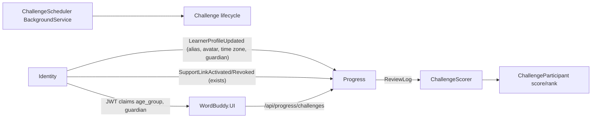

# Plan: WB-29 Vocabulary challenges

## Summary

Add system-created vocabulary challenges to the **Progress** service, because it owns `ReviewLog`.
Scores are a pure projection of `ReviewLog`, rebuildable at any time.
Identity owns the new time zone and Guardian role, and sends profile data to Progress by event.

## Affected services / areas

| Area | Change |
| --- | --- |
| Shared.Contracts | New `LearnerProfileUpdated` event (minor version bump) |
| Identity | `User.TimeZoneId` (IANA), `User.IsGuardian` role, `guardian` JWT claim, publish event, migration |
| Progress | Domain, CQRS features, scheduler, scorer, consumer, endpoints, migration |
| WordBuddy.UI | Time zone setting, `ChallengesPage`, `ChallengeBoardPage`, guardian toggle |
| docs | `docs/features/vocabulary-challenges.md` (tester updates on merge) |

## Backend approach

### Identity — time zone and Guardian role

| Item | Design |
| --- | --- |
| `User.TimeZoneId` | IANA id (`Asia/Ho_Chi_Minh`), nullable. `SetTimeZone(id)` validates with `TimeZoneInfo.TryFindSystemTimeZoneById` → `UserErrors.UnknownTimeZone` |
| Set time zone | New command `UpdateProfileTimeZone` + `PUT /api/auth/profile/time-zone`. Register accepts optional `timeZoneId` (UI sends browser zone) |
| `User.IsGuardian` | Role flag. Adult accounts only (`UserErrors.GuardianMustBeAdult`) |
| Grant role | Admin-only command `SetGuardianRole` + `PUT /api/auth/admin/users/{id}/guardian` (policy `AdminOnly`) |
| JWT | Adds `guardian=true` claim when `IsGuardian` |
| Event | Publish `LearnerProfileUpdated(UserId, AgeGroup, Alias, AvatarId, DisplayName, TimeZoneId, IsGuardian, OccurredAtUtc)` after register, alias/avatar, time zone or guardian change. `DisplayName` null for Child |

### Progress — domain (new)

| Type | Key fields / rules |
| --- | --- |
| `Challenge` | `Id`, `TemplateKey`, `Audience` (Adult/Child), `Kind` (Ranked/Target), `Metric`, `Target?`, `OpensAtUtc`, `StartsAtUtc`, `EndsAtUtc`, `Capacity` (default 30), `Status` |
| `ChallengeStatus` | `Scheduled → Open → Running → Finished`; forward only, via `Open()`, `Start()`, `Finish()` returning `Result` |
| `ChallengeAudience` | `Adult`, `Child` — never mixed; join fails with `Challenge.AudienceMismatch` |
| `ChallengeKind` | `Ranked`, `Target` |
| `ChallengeMetric` | Fixed catalog: `MemoryPoints`, `DueReviewsCorrect`, `RecallUpgrades`, `ListeningCorrect` |
| `ChallengeParticipant` | `ChallengeId`, `UserId`, `JoinedAtUtc`, `Score`, `Rank?`, `TargetReached` |
| `ChallengeProfile` | Local copy per user: `UserId`, `AgeGroup`, `Alias?`, `AvatarId?`, `DisplayName?`, `TimeZoneId?`, `IsGuardian` |
| `ChallengeConsent` | `ChildId`, `EnabledBy` (guardian id), `EnabledAtUtc` |
| `ChallengeTemplates` | Static launch set (below) |
| `LearnerDayResolver` | `(DateTime utc, string? timeZoneId) → DateOnly` local day. Missing/unknown zone → UTC fallback |
| `ChallengeScorer` | Pure: `(logs, metric, window, timeZoneId, settings) → int` |

Launch set:

| Template | Kind | Metric | Period | Audience |
| --- | --- | --- | --- | --- |
| Weekly League | Ranked | MemoryPoints | Mon–Sun | Adult + Child (separate instances) |
| 7-Day Memory | Target | DueReviewsCorrect, ≥ 1 on 7 local days | 7 days | Adult + Child |
| Word Climber | Target | RecallUpgrades, target 20 | 14 days | Adult + Child |
| Listening Sprint | Ranked | ListeningCorrect | 3 days | Adult only |

Challenge windows are global UTC instants (same for every participant). Only the **daily cap** and **daily goal** use the learner's local day.

### Scoring rules (`ChallengeScorer`)

Per log row, inside the challenge window and after `JoinedAtUtc`:

| Rule | Points |
| --- | --- |
| `IsDue && IsCorrect && AttemptNo == 1 && !HintUsed` | +10 |
| Same, with `HintUsed` | +5 |
| First correct `Recall` for a sense whose earlier correct logs were only `Recognize` | +5 |
| Daily goal: 10 correct due reviews in one local day (config `Challenges:DailyGoalCorrectDue`) | +10 |
| Cap per user per local day (config, 200) | 200 |

Ignored rows:

- `!IsDue` (non-due review).
- Wrong answers, and any row with `TimingAdjusted` or `ResponseMs` < 800 ms (config `Challenges:FastAnswerFloorMs`).
- New words: the first review of a sense (no earlier log for that user + sense).

Local day = `LearnerDayResolver(OccurredAtUtc, profile.TimeZoneId)`. A time zone change applies on the next rebuild to all rows; this is accepted (rebuild stays deterministic for one profile state).

Projection: `RecomputeChallengeScoresCommand` rewrites `Score` and dense `Rank` for all participants of Running challenges. Run every 5 min and at `Finish()`.

### Progress — features (develop-webapi layout)

| Feature folder | Use case | Notes |
| --- | --- | --- |
| `Challenges/Queries/ListChallenges` | Open + Running for caller's audience | Audience from `age_group` claim; Child without consent gets empty list |
| `Challenges/Queries/GetChallengeBoard` | Board | Adult: full ranking, alias or display name. Child: own row + top 5, alias + avatar only |
| `Challenges/Commands/JoinChallenge` | Opt-in | Audience, status Open/Running, child consent; at capacity → `Challenge.Full` (no overflow) |
| `Challenges/Commands/LeaveChallenge` | Opt-out | Removes participant |
| `Challenges/Commands/SetChildChallengeConsent` | Guardian enables/disables | Needs **both**: caller has Guardian role (`guardian` claim, checked again against `ChallengeProfile.IsGuardian`) **and** an active support link to the child. Else `Challenge.NotGuardian` / `Challenge.NoActiveLink` |
| `Challenges/Commands/AdvanceChallengeLifecycle` | Scheduler | Creates next instances from templates, moves statuses by time |
| `Challenges/Commands/RecomputeChallengeScores` | Scheduler | Projection above |

Revoked support link (`SupportLinkRevoked`, existing consumer) or Guardian role removed → delete matching `ChallengeConsent`.

Endpoints (`ChallengesController`, `/api/progress/challenges`):

| Verb | Route | Policy |
| --- | --- | --- |
| GET | `/` | authenticated |
| GET | `/{id}/board` | authenticated, same audience |
| POST | `/{id}/join` | authenticated; rate-limited |
| DELETE | `/{id}/join` | authenticated |
| PUT | `/consent/{childId}` | new policy `GuardianOnly` (`guardian` claim) |

Caching: board uses key `progress:challenge-board:{id}`, absolute expiry 5 min; deleted after recompute/join/leave. Child filtering happens after cache read.

Infrastructure: `ChallengeSchedulerHostedService` (1-min tick, 5-min recompute), repositories, `LearnerProfileUpdatedConsumer` (idempotent upsert, ignores older `OccurredAtUtc`).

### Child behaviour (explicit)

| Concern | Child | Adult |
| --- | --- | --- |
| See / join | Only after Guardian consent; child audience only | Opt-in, adult audience only |
| Board | Own rank + top 5 | Full |
| Name | Alias or "Child learner" + fixed avatar | Alias or display name |
| Rewards | None yet (no badges in this change) | Rank only |
| Listening Sprint | Not created | Yes |
| Guardian role | Cannot hold it | Can be granted by admin |
| Contact | None — no user ids, no messaging in any DTO | None |

## Frontend approach

- `src/types/index.ts`: `Challenge`, `ChallengeBoard`, `ChallengeBoardEntry`, unions `ChallengeStatus`, `ChallengeKind`, `ChallengeAudience`; `timeZoneId`, `isGuardian` on user.
- `src/api/challenges.ts`: list, board, join, leave, consent. `src/api/auth.ts`: `updateTimeZone`; register sends `Intl.DateTimeFormat().resolvedOptions().timeZone`.
- Profile settings: time zone select (IANA list from `Intl.supportedValuesOf('timeZone')`).
- `ChallengesPage`: cards, join/leave, `Challenge.Full` shown as "This challenge is full". Child without consent → "Ask your guardian".
- `ChallengeBoardPage`: adult table; child own rank + top 5 with avatar + alias. Server filters; UI does not hide data itself.
- Supporter dashboard: "Allow challenges" toggle per child, shown only when the JWT has `guardian`.
- Routes + sidebar link. Framer Motion entrance, theme tokens, `isError` handled.

## Data / migration notes

- Identity migration `AddTimeZoneAndGuardian`: `Users.TimeZoneId nvarchar(64) null`, `Users.IsGuardian bit not null default 0`.
- Progress migration `AddChallenges`: `Challenges`, `ChallengeParticipants` (unique `ChallengeId+UserId`), `ChallengeProfiles`, `ChallengeConsents`; index `ReviewLogs (UserId, OccurredAtUtc)` if missing.
- Existing users: no profile row in Progress until their next profile event → Identity one-off backfill publish (task) so challenges see alias and zone.
- Shared.Contracts: new package version, `make publish-shared`.

## Open questions

Resolved by Sam (2026-10-11):

1. ~~Daily goal~~ — 10 correct due reviews per local day, config.
2. ~~Recognize → Recall~~ — interpretation confirmed.
3. ~~Day boundary~~ — learner's IANA time zone from Identity, carried by event; UTC only as fallback when unset.
4. ~~Guardian~~ — Guardian is an account role; consent needs role **and** active link.
5. ~~Badges~~ — out of this change; adults get rank only, children nothing extra.
6. ~~Fast-answer floor~~ — 800 ms.
7. ~~Full league~~ — no overflow; join rejected with `Challenge.Full`.

Still open (judgment calls, not blocking):

- Who grants the Guardian role? Plan: admin-only endpoint. A self-service or verified flow is a scope suggestion.
- Time zone change rescores past days on next rebuild. Accepted for now; freeze per day later if abuse appears.

Scope ideas (not in this change): badge catalog; Guardian self-service request flow; challenge history page; Notification on open/finish (phase 2).
