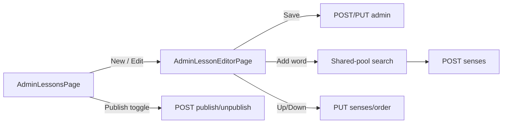

# Plan: WB-47 Admin lesson authoring

## Summary

Add admin-only lesson write endpoints (update, publish, unpublish, delete, attach / detach / reorder senses) and an admin list that includes drafts in Content. Add an admin lesson authoring UI.

## Affected services / areas

| Area | Change |
| --- | --- |
| Content.Domain | `Lesson` gains mutators; `LessonSense` gains `SortOrder` setter |
| Content.Application | 7 new commands, 1 new admin query, child filter fix in `GetLessonDetail` / `GetLessons` |
| Content.Api | New `LessonsAdminController` (`AdminOnly`); `POST /api/lessons` moves there |
| WordBuddy.UI | `api/lessons.ts` write functions, `AdminLessonsPage`, `AdminLessonEditorPage` |
| Other services | None. No events, no new contracts. |

## Backend approach

### Domain (`Lesson`)

- `Title`, `Description`, `Level`, `TargetAgeGroup` get `private set`. `Type` stays immutable.
- New methods, each returning `Result`:
  - `UpdateDetails(title, description, level, targetAgeGroup)`
  - `Publish()` / `Unpublish()` — idempotent.
  - `AttachSense(Sense)` — fails `Lesson.SenseAlreadyAttached`; fails `Lesson.NotVocabulary` when `Type != Vocabulary`; appends at end.
  - `DetachSense(Guid senseId)` — fails `Lesson.SenseNotAttached`; renumbers `SortOrder` 0..n-1.
  - `ReorderSenses(IReadOnlyList<Guid> orderedSenseIds)` — list must be exactly the attached set, else `Lesson.InvalidOrder`.
- `LessonSense.SortOrder` gets an internal setter used only by `Lesson`.

### Sense eligibility (attach)

A sense may be attached only if it is a **system sense** or `ShareStatus = Shared`. `Private`, `PendingReview`, `Rejected` → `Validation` error `Lesson.SenseNotEligible`. Rule lives in the attach handler (needs repository lookup).

### Commands / queries

Follow `.claude/skills/develop-webapi/SKILL.md` templates. All under `Features/Lessons/`.

| Use case | Type | Endpoint | Result |
| --- | --- | --- | --- |
| `CreateLesson` (existing) | Command | `POST /api/lessons/admin` | `201` + id. Created as draft (`isPublished: false`). |
| `UpdateLesson` | Command | `PUT /api/lessons/admin/{id}` | `204` |
| `PublishLesson` | Command | `POST /api/lessons/admin/{id}/publish` | `204` |
| `UnpublishLesson` | Command | `POST /api/lessons/admin/{id}/unpublish` | `204` |
| `DeleteLesson` | Command | `DELETE /api/lessons/admin/{id}` | `204` |
| `AttachLessonSense` | Command | `POST /api/lessons/admin/{id}/senses` `{ senseId }` | `204` |
| `DetachLessonSense` | Command | `DELETE /api/lessons/admin/{id}/senses/{senseId}` | `204` |
| `ReorderLessonSenses` | Command | `PUT /api/lessons/admin/{id}/senses/order` `{ senseIds[] }` | `204` |
| `GetAdminLessons` | Query | `GET /api/lessons/admin?type&level&isPublished` | drafts + published, with `isPublished`, `senseCount` |
| `GetAdminLessonDetail` | Query | `GET /api/lessons/admin/{id}` | draft-capable detail, unfiltered senses, with `sortOrder`, `visibleToChildren`, `shareStatus` |

- New `LessonsAdminController`, route `api/lessons/admin`, class-level `[Authorize(Policy = "AdminOnly")]` (same as `VocabularyAdminController`). Fits the existing `/api/lessons` ingress / proxy prefix — no routing change.
- Remove `POST` from `LessonsController`. Non-admins → `403`.
- Errors: `Lesson.NotFound` (404), `Sense.NotFound` (404), the domain errors above (400 / 409 for `SenseAlreadyAttached`).
- Sense search for the attach picker: reuse the existing shared-pool endpoint used by `VocabularySharedPoolPage` (`api/vocabulary.ts`). Coder confirms it returns system senses too; if not, see Open questions.

### Repository

`ILessonRepository` adds `GetByIdForUpdateAsync` (tracked, includes `LessonSenses`), `ListAllAsync(filters)`, `Remove(Lesson)`, `SaveChangesAsync`. `ISenseRepository` (or existing equivalent) `GetByIdAsync` for attach.

Delete: EF config must cascade `Lesson → LessonSense` and **restrict** `LessonSense → Sense`. Verify in `LessonSenseConfiguration`; current mapping likely already does this.

### Caching

Lesson queries are not cached today. No new cache. If coder finds `content:lesson:{id}` keys, delete them after each write command.

### Child / adult behaviour

| Who | Behaviour |
| --- | --- |
| Admin | Full read/write on `/api/lessons/admin/*`; sees drafts and all senses. |
| Adult | Unchanged. Reads published lessons only. |
| Child | List: published + `TargetAgeGroup = Child` only. Detail: draft or adult-targeted lesson → `404`; senses with `VisibleToChildren = false` removed. |

Gap found: `GetLessonDetailQueryHandler` does **not** filter by `IsPublished`, `TargetAgeGroup`, or `VisibleToChildren` today. `GetLessonsQueryHandler` needs checking for the child age-group filter. This plan fixes both (success criterion 4).

## Frontend approach

- `src/api/lessons.ts`: add `getAdminLessons`, `getAdminLessonDetail`, `createLesson`, `updateLesson`, `publishLesson`, `unpublishLesson`, `deleteLesson`, `attachLessonSense`, `detachLessonSense`, `reorderLessonSenses`.
- `src/types/index.ts`: `AdminLessonDto`, `AdminLessonDetailDto`, `AdminLessonSenseDto`, `LessonFormValues`.
- Query keys: `['adminLessons', filters]`, `['adminLesson', id]`. Mutations invalidate both plus `['lessons']`.
- `AdminLessonsPage` (`/admin/lessons`): table with status badge, filters, "New lesson", publish toggle, delete with confirm dialog.
- `AdminLessonEditorPage` (`/admin/lessons/new`, `/admin/lessons/:id`): React Hook Form + Zod details form; senses panel (list, detach, up / down buttons for reorder, "Add word" picker using shared-pool search). Child-hidden senses show a "Hidden from children" badge.
- Routes inside `AppLayout`, guarded like `VocabularyModerationPage` (admin role). Sidebar link for admins only.
- Up / down buttons, not drag-and-drop: no new dependency. Framer Motion `layout` for reorder animation.
- `isError` states handled on both pages.

## Data / migration notes

- No new tables or columns. `Lessons.IsPublished` and `LessonSenses.SortOrder` exist.
- Migration only if FK delete behaviour on `LessonSenses` must change. Coder checks the model snapshot first.

## Open questions

1. Does `POST /api/lessons` move to `/api/lessons/admin` (breaking) or stay with `AdminOnly` added? Plan: move. No UI caller exists today; seeder does not use HTTP.
2. New lessons default to draft. The domain constructor default is `isPublished = true` (seeder relies on it). Plan: command passes `false` explicitly.
3. Attach eligibility: system or `Shared` only. Should an admin also attach `PendingReview` senses? Plan: no.
4. Child-targeted lesson with a sense `VisibleToChildren = false`: allow attach with a warning badge (plan) or block?
5. Does the shared-pool search return system senses? If not, a small admin sense search query is added (1 extra task).
6. Scope ideas (not in this plan): drag-and-drop reorder; grammar / daily phrase authoring; audit trail of lesson edits.
