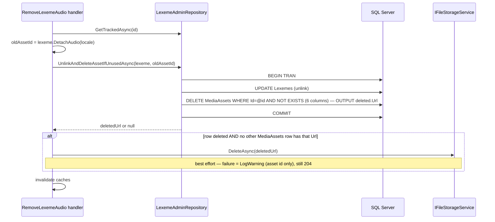

# Plan: WB-50 Lexeme admin view

## Revision 1 — 2026-10-14

Sam answered the open questions of the first plan.

| # | Topic | Change |
| --- | --- | --- |
| 1 | POS required on edit | Kept as planned |
| 2 | Private learner senses | Kept: count only |
| 3 | Search | **Changed:** "contains" search with escaped `LIKE`; prefix matches ranked first; no migration, no new index |
| 4 | Audio removal | **Changed:** `DELETE` removes the `MediaAsset` row and the file when nothing else references the asset; new `IFileStorageService.DeleteAsync` |
| 5 | Concurrent edits | No answer: last write wins; still an open question |

## Summary

Add an admin-only lexeme screen in Content and the UI. Admins search lexemes (paged, "contains"
search), open one to see its senses, correct its dictionary fields, and upload or remove UK/US
audio. No new service, no new entity, no migration.

```mermaid
flowchart LR
  L["/admin/lexemes<br/>search + filters + pages"] --> D["/admin/lexemes/:id<br/>fields form · senses · audio"]
  D -- "PUT fields" --> API[Content<br/>LexemesAdminController]
  D -- "PUT/DELETE audio/{locale}" --> API
  API --> DB[(Lexemes · MediaAssets)]
  API --> BLOB[(blob: audio/lexeme-{id}-{locale}.mp3)]
  API -. "delete keys" .-> C[(IDistributedCache)]
```

## Affected services / areas

| Area | Change |
| --- | --- |
| Content (backend) | New `LexemesAdmin` feature: 2 queries, 3 commands, 1 controller, 1 repository, 2 domain methods, `IFileStorageService.DeleteAsync` |
| WordBuddy.UI | 2 new admin pages, 3 components, API module, hooks, types, nav item, routes |
| Identity, Quiz, Progress, Notification | None |
| Infra (Vite proxy, Nginx, k8s Ingress) | None — `/api/vocabulary` already routes to Content |

## Child vs adult behaviour

| Caller | Behaviour |
| --- | --- |
| Admin | Full access to every endpoint and page |
| Adult learner | `403` on every endpoint; UI redirects to `/` |
| Child learner | `403` on every endpoint; UI redirects to `/`; nav item hidden |

- Every endpoint carries `[Authorize(Policy = "AdminOnly")]` at controller level.
- Edited lexeme fields reach children only through the existing paths (lessons, shared pool,
  auto-fill). The existing masking stays unchanged: `AutofillSenseDto.Masked()` still hides
  IPA and audio for a sense that awaits child approval.
- Privacy: the admin detail view shows full text only for catalog senses (System or Shared).
  Private, pending and rejected learner senses appear as a count only. Pending words stay
  visible on the existing moderation page.

## Backend approach

All new code follows `.claude/skills/develop-webapi/SKILL.md` (CQRS folders, validator,
handler logging, `ToProblemResult`). Closest existing pattern: `Features/Lessons` +
`LessonsAdminController`.

### Endpoints — `LexemesAdminController`, route `api/vocabulary/admin/lexemes`, `AdminOnly`

| Method | Route | Handler | Success | Failures |
| --- | --- | --- | --- | --- |
| GET | `/api/vocabulary/admin/lexemes?search=&partOfSpeech=&cefrLevel=&page=1&pageSize=25` | `GetAdminLexemesQuery` | `200 AdminLexemePageDto` | `400` |
| GET | `/api/vocabulary/admin/lexemes/{id}` | `GetAdminLexemeDetailQuery` | `200 AdminLexemeDetailDto` | `404` |
| PUT | `/api/vocabulary/admin/lexemes/{id}` | `UpdateLexemeCommand` | `204` | `400`, `404`, `409` |
| PUT | `/api/vocabulary/admin/lexemes/{id}/audio/{locale}` (multipart, one `file`) | `UploadLexemeAudioCommand` | `200 MediaAssetDto` | `400`, `404` |
| DELETE | `/api/vocabulary/admin/lexemes/{id}/audio/{locale}` | `RemoveLexemeAudioCommand` | `204` | `400`, `404` |

`{locale}` is `en-GB` or `en-US` (`Lexeme.UkLocale` / `Lexeme.UsLocale`). `DELETE` on a locale
with no audio returns `204` (idempotent).

### Domain — `Lexeme` (no new properties)

| Method | Rule |
| --- | --- |
| `Correct(PartOfSpeech pos, string? ipaUk, string? ipaUs, string? syllables, IReadOnlyList<string> wordForms, CefrLevel? cefr, int? frequencyRank)` | Full replace (unlike `Enrich`, which keeps old values). Empty strings → `null`. Too long → `Validation` error, never truncation. Word forms trimmed, de-duplicated (case-insensitive), empties dropped. |
| `DetachAudio(string locale)` → `Result<Guid?>` | Clears `UkAudioAssetId` or `UsAudioAssetId` and returns the old asset id (`null` = nothing linked). Other locale → `Lexeme.InvalidAudioLocale`. |

`Lemma` and `NormalizedLemma` are not editable (rename = merge/split, out of scope).

### Validation limits

| Field | Rule |
| --- | --- |
| `PartOfSpeech` | required, `IsInEnum` (cannot be reset to unknown — confirmed by Sam) |
| `IpaUk`, `IpaUs` | optional, ≤ 100 (column limit) |
| `Syllables` | optional, ≤ 200 (column limit) |
| `WordForms` | ≤ 20 items, each ≤ 100 chars (column is `nvarchar(max)`) |
| `CefrLevel` | optional, `IsInEnum` |
| `FrequencyRank` | optional, 1 … 1 000 000 |
| `search` | optional, ≤ 200 (= `Lexeme.LemmaMaxLength`), trimmed; empty = no filter |
| `page` / `pageSize` | `page ≥ 1`; `pageSize` 1 … 100, default 25 |
| audio file | `audio/mpeg` only (stored name ends in `.mp3`), 1 byte … 5 MB |

### Search — "contains" with escaped `LIKE`

```text
term    = Sense.NormalizeWord(search)                 // trim + upper-case, same as the column
escaped = LikePattern.Escape(term)                    // \ → \\, % → \%, _ → \_, [ → \[
WHERE   NormalizedLemma LIKE N'%' + escaped + N'%' ESCAPE N'\'
ORDER BY CASE WHEN NormalizedLemma LIKE escaped + N'%' ESCAPE N'\' THEN 0 ELSE 1 END,
         NormalizedLemma, PartOfSpeech, Id
```

- LINQ: `EF.Functions.Like(l.NormalizedLemma, "%" + escaped + "%", @"\")` in `Where`; the same
  call with `escaped + "%"` inside the conditional in `OrderBy`. EF translates both to SQL; the
  term is always a parameter.
- `LikePattern.Escape` is a small static helper in Infrastructure (`Persistence/LikePattern.cs`).
  It escapes the escape character `\` first, then `%`, `_`, `[`.
- Ranking is cheap: the `CASE` runs only on rows that already matched.
- `COUNT(*)` for `TotalCount` uses the same `WHERE`.

**Cost and migration: none needed.**

- `LIKE '%x%'` cannot seek. SQL Server scans the narrow unique index
  `UX_Lexemes_NormalizedLemma_PartOfSpeech` (two short columns), not the table.
- Admin volume is low (a few searches per minute). Tens of thousands of lexemes scan in a few
  milliseconds. Two scans per page (rows + count) are acceptable.
- Revisit (n-gram table or full-text index) only if lexemes grow past about 100 000.

### Unique (lemma, POS) rule → `409`

1. Handler pre-check: `ExistsWithPartOfSpeechAsync(normalizedLemma, pos, excludeId)` →
   `Error.Conflict("Lexeme.DuplicatePartOfSpeech", ...)`.
2. Race safety net: the repository catches SQL `2601`/`2627` on
   `UX_Lexemes_NormalizedLemma_PartOfSpeech` in `SaveChangesAsync` and returns the same conflict
   (pattern: `AutofillRepository.SaveAsync`).

### Audio — upload (PUT) through the existing blob path

Editing audio means **uploading an MP3**, not typing a URL. The file name follows
`Lexeme.AudioFileName` (`lexeme-{id}-{locale}.mp3`, stored under `audio/`).

```text
PUT .../audio/en-GB (file)
  path = IFileStorageService.SaveNamedAsync(stream, Lexeme.AudioFileName(id, "en-GB"))   // overwrites in place
  current UK asset exists AND current.Url == path → keep it (no new row, no orphan)
  otherwise → new MediaAsset(Audio, path) + Lexeme.AttachAudio
              → if an old asset was replaced: run the guarded cleanup below on it
  → one SaveChanges → invalidate caches → 200 MediaAssetDto
```

- **Confirmed: no orphan on replace.** `SaveNamedAsync` uses `File.Create` on a fixed path, so
  it overwrites the old file in place. Every lexeme audio written so far (auto-fill) uses that
  same path, so the normal case reuses the existing `MediaAsset` row.
- The "otherwise" branch only covers an old asset with a different path (for example, data from
  an older seed). The old asset then goes through the guarded cleanup, so it is not orphaned.
- Overwriting keeps the URL, so a browser may play a cached old file. The admin UI adds a
  `?v=<timestamp>` query to its own preview after an upload.

### Audio — remove (DELETE) with guarded cleanup

**Reference check (exact).** A `MediaAsset` `@id` is unreferenced when none of the six FK columns
that point to `MediaAssets` holds it:

| Table | Column |
| --- | --- |
| `Lexemes` | `UkAudioAssetId`, `UsAudioAssetId` |
| `Senses` | `AudioAssetId`, `ImageAssetId` |
| `DailyPhrases` | `AudioAssetId`, `VideoAssetId` |

The file is deleted only when, in addition, no other `MediaAssets` row has the same `Url`.

**Order — DB first, then the file.**



- The guarded `DELETE … WHERE NOT EXISTS` is one SQL statement (same style as the orphan
  lexeme delete in `AutofillRepository.SaveAsync`). Concurrent new references therefore cannot
  slip in between check and delete.
- All six FKs are `NoAction`. If a concurrent insert still wins, SQL error `547` is caught: the
  row stays, the unlink still commits, and the file is kept.
- Shared asset (still referenced) → the unlink commits, and the row and file stay.
- A file-delete failure after the commit leaves only an orphan file, never a dangling reference.
  It is logged as a warning with the asset id (no path, no user data).
- The same `UnlinkAndDeleteAssetIfUnusedAsync` path serves PUT's "old asset replaced" branch.

### Storage — new `IFileStorageService.DeleteAsync`

| Item | Rule |
| --- | --- |
| Signature | `Task<bool> DeleteAsync(string relativePath, CancellationToken ct = default)` — `true` deleted, `false` file did not exist |
| `LocalFileStorageService` | Resolve `Path.GetFullPath(Path.Combine(BasePath, relativePath))`. Refuse (return `false`, log warning) any path outside `BasePath` (path-traversal guard). Then `File.Delete`. IO errors propagate to the handler, which catches and logs them. |
| Other implementations | None in `src/`. Unit tests use `Mock<IFileStorageService>`, which needs no change. |

### Repository — new `ILexemeAdminRepository` (Application) / `LexemeAdminRepository` (Infrastructure)

| Method | Notes |
| --- | --- |
| `SearchAsync(search, pos, cefr, page, pageSize)` → `(items, totalCount)` | Projection, `AsNoTracking`, "contains" search as above. Per row: catalog-sense count, private-learner-sense count, display lemma, audio flags. |
| `GetDetailAsync(id)` | Lexeme + `UkAudio` + `UsAudio` + senses (`AsSplitQuery`). |
| `GetTrackedAsync(id)` | Tracked lexeme with audio navigations, for commands. |
| `ExistsWithPartOfSpeechAsync(normalizedLemma, pos, excludeId)` | Pre-check for `409`. |
| `AddMediaAsset(asset)` + `SaveChangesAsync()` | One save per command; maps unique violation to `409`. |
| `UnlinkAndDeleteAssetIfUnusedAsync(lexeme, assetId)` → `Result<string?>` | One transaction (execution strategy): save lexeme, guarded `DELETE … OUTPUT deleted.Url`, catch `547`. Returns the deleted row's `Url` or `null`. |
| `IsUrlUsedAsync(url)` | Any other `MediaAssets` row with this `Url` — the file-delete guard. |

Display lemma (ADR 0004 — never show another learner's spelling): first catalog sense word
whose normalized form matches (reuse `Lexeme.RederiveLemma` in the detail handler); fallback =
`NormalizedLemma` in lower case.

### DTOs (`Application/DTOs/AdminLexemeDtos.cs`)

| DTO | Fields |
| --- | --- |
| `AdminLexemeListItemDto` | `Id, Lemma, PartOfSpeech?, IpaUk?, IpaUs?, CefrLevel?, FrequencyRank?, HasUkAudio, HasUsAudio, CatalogSenseCount, PrivateLearnerSenseCount` |
| `AdminLexemePageDto` | `Items, TotalCount, Page, PageSize` |
| `AdminLexemeDetailDto` | list fields + `Syllables?, WordForms, AudioUkUrl?, AudioUsUrl?, CreatedAtUtc, Senses (AdminLexemeSenseDto[]), PrivateLearnerSenseCount` |
| `AdminLexemeSenseDto` | `Id, Word, Definition, Example?, Source, ShareStatus, Origin, VisibleToChildren, CreatedAtUtc` — catalog senses only |

### Caching

Admin queries are not cached (low read volume, must show fresh data). After every successful
command, `LexemeCacheInvalidator` deletes the keys that copy lexeme fields:

| Key | Why |
| --- | --- |
| `AutofillCacheKeys.Catalog(lexeme.NormalizedLemma)` | `AutofillSenseDto` holds POS, IPA, audio URLs |
| `SharedVocabularyCacheKeys.ChildSafe` and `.All` | `PersonalVocabularyWordDto` holds POS, IPA, audio URLs |

Checked, no action needed:

| Place | Reason |
| --- | --- |
| Progress `progress:session-senses:{sessionId}` | `ContentSenseDto` carries `Sense.Audio`, not lexeme audio, and no lexeme field |
| Lesson detail / admin lesson detail | Not cached |
| Quiz, Identity, Notification | Hold no lexeme data |

### Messaging

None. No other service stores lexeme data, so no `WordBuddy.Shared.Contracts` change.

### Logging

Ids, locale, POS and counts only. Never log sense text, lemma, file paths or learner ids.

## Frontend approach

Pattern: `AdminLessonsPage` / `AdminLessonEditorPage` / `useAdminLessons`.

| Item | File | Notes |
| --- | --- | --- |
| Types | `src/types/index.ts` | `CefrLevel` union, `AudioLocale = 'en-GB' \| 'en-US'`, `AdminLexemeListItem`, `AdminLexemePage`, `AdminLexemeDetail`, `AdminLexemeSense`, `AdminLexemeFilters`, `UpdateLexemeValues` |
| API | `src/api/lexemes.ts` | `getAdminLexemes`, `getAdminLexeme`, `updateLexeme`, `uploadLexemeAudio` (`FormData`), `removeLexemeAudio` |
| Hooks | `src/hooks/useAdminLexemes.ts` | Queries `['adminLexemes', filters]` (`placeholderData: keepPreviousData`), `['adminLexeme', id]`. Mutations invalidate `adminLexemes`, `adminLexeme`, `vocabulary`, `lesson`, `adminLesson` |
| List page | `src/pages/AdminLexemesPage.tsx` → `/admin/lexemes` | Search box (300 ms debounce, hint "matches any part of the word"), POS and CEFR selects, table, Prev/Next pager with "Page x of y". Loading / error / empty states |
| Editor page | `src/pages/AdminLexemeEditorPage.tsx` → `/admin/lexemes/:id` | Header (lemma, POS badge), form, audio panel, senses panel |
| Form | `src/components/admin-lexemes/LexemeForm.tsx` | React Hook Form + Zod, same limits as the backend validator. Word forms = one per line in a textarea. Shows `409` detail via `problemMessage` |
| Audio | `src/components/admin-lexemes/LexemeAudioPanel.tsx` | Per locale: play, upload (`accept="audio/mpeg"`), remove with `ConfirmDialog` ("The audio file is deleted unless another item still uses it.") |
| Senses | `src/components/admin-lexemes/LexemeSensesPanel.tsx` | Read-only list of catalog senses with source / share / origin / child badges; line "N private learner senses (not shown)" |
| Nav + routes | `src/layouts/AppLayout.tsx`, `src/App.tsx` | `ADMIN_NAV_ITEMS` gets "Lexemes"; two routes next to `/admin/lessons` |

- Non-admin → `<Navigate to="/" replace />` (UX guard; server enforces `AdminOnly`).
- Every page handles `isError` without a blank screen.
- Tailwind utilities + existing `supportUi` classes; theme tokens only; Framer Motion page entry.
- Search and page live in component state (not Zustand, not the URL) — same as lesson filters.
- `%`, `_` and `[` in the search box are sent as typed; the backend escapes them.

## Data / migration notes

**None.**

- All fields exist on `Lexemes` since `SplitVocabularyIntoLexemesAndSenses` /
  `AddVocabularyAutofill`.
- "Contains" search scans the existing narrow index `UX_Lexemes_NormalizedLemma_PartOfSpeech`;
  acceptable at admin volume (see Search).
- Sense counts use the existing FK index on `Senses.LexemeId`.
- The `MediaAssets` cleanup uses existing FK columns; each has an EF-created index, so the six
  `NOT EXISTS` probes are seeks.

## Line endings

- New files: LF.
- Edited files: keep the EOL they have on `main`.
- Before commit: `git diff --shortstat main` must equal `git diff --shortstat --ignore-cr-at-eol main`
  (see `docs/ai/learnings.md`, 2026-10-14).

## Open questions

1. **Concurrent edits (still open).** Last write wins (no row version on `Lexemes`). Two admins
   editing the same lexeme silently overwrite each other. OK for a small admin team, or add an
   optimistic concurrency token (needs a migration)?
2. Scope ideas beyond this issue (not planned): see report — "missing POS / IPA / audio" filter,
   lemma rename/merge/split, cleanup of audio left behind by automatic orphan-lexeme deletes,
   edit audit trail.
