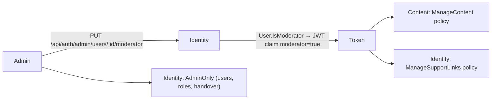

# Plan: WB-56 Moderator role to assist admin

## Summary

Add an `IsModerator` flag on `User`, issued as a `moderator` JWT claim. Content and Identity get a new
policy "admin OR adult moderator" on content and support-link endpoints. User and role endpoints stay `AdminOnly`.
A new admin screen `/admin/users` lists adult accounts and grants or revokes Moderator.

### Who can do what

| Area | Admin | Moderator (adult) | Adult learner | Child |
| --- | --- | --- | --- | --- |
| Vocabulary moderation (pending, moderate, autofill queue, approve for all children) | yes | yes | no | no |
| Lesson authoring (`/api/lessons/admin`) | yes | yes | no | no |
| Lexeme admin (`/api/vocabulary/admin/lexemes`) | yes | yes | no | no |
| Escalated unlink requests (list, complete, reject) | all | adult learners only | no | no |
| Primary handover + learner link lookup (child-only flow) | yes | no | no | no |
| Backfills (`learner-words/republish`, `learner-profiles/republish`) | yes | no | no | no |
| Guardian role, Moderator role, user list | yes | no | no | no |

## Affected services / areas

| Area | Change |
| --- | --- |
| Identity | `User.IsModerator` + migration, JWT claim, `SetModeratorRole` command, `GetUsersForAdmin` query, `ManageSupportLinks` policy, child filter in unlink admin flow, "admin cannot be deleted" guard |
| Content | `ManageContent` policy; swap `AdminOnly` on content endpoints |
| Progress, Quiz, Notification | None. Moderators are adults, so existing `is_admin` checks (`ChildHasSupporter`) do not change for them |
| Shared packages | None. No new contract, no version bump |
| WordBuddy.UI | Role helper, split nav, page gates, new `AdminUsersPage` |

## Backend approach

All new handlers follow `.claude/skills/develop-webapi/SKILL.md`. The pattern to copy is WB-29 Guardian:
`SetGuardianRoleCommand` + `User.SetGuardian` + `PUT /api/auth/admin/users/{id}/guardian`.

### Identity

**Domain (`User`)**

- `bool IsModerator { get; private set; }`.
- `Result SetModerator(bool isModerator)`:
  - grant on Child → `User.ModeratorMustBeAdult` (400);
  - grant on an admin → `User.ModeratorNotForAdmin` (400), because admins already have every right;
  - revoke always succeeds.
- `Result EnsureCanBeDeleted()` → `User.AdminCannotBeDeleted` (409) for admins. No delete feature exists today. This guard is the rule any future delete command must call (see Open questions).

**Token**

- `JwtTokenGenerator`: add `moderator = "true"` only when `IsModerator`. Same pattern as `guardian`.
- `UserDto`: add `IsModerator`.
- No refresh endpoint exists. Tokens live `Jwt:ExpiryMinutes` (60). A role change shows after the next login. Revoke lag is at most 60 minutes (see Open questions).

**Policies (`AuthorizationPolicies`)**

| Policy | Rule |
| --- | --- |
| `AdminOnly` (existing) | `is_admin = true` |
| `ManageSupportLinks` (new) | `is_admin = true` OR (`moderator = true` AND `age_group != Child`) |

The age check repeats the domain rule as defence in depth. Add `ClaimsPrincipal.IsAdmin()` in Identity Api `Extensions` to pass the caller kind into handlers.

**Commands and queries**

| Use case | Folder | Endpoint | Policy |
| --- | --- | --- | --- |
| `SetModeratorRoleCommand(AdminId, TargetUserId, IsModerator)` | `Features/Profile/Commands/SetModeratorRole/` | `PUT /api/auth/admin/users/{id}/moderator` body `{ isModerator }` → 204 | `AdminOnly` |
| `GetUsersForAdminQuery(Search?, Page, PageSize)` → `PagedResult<AdminUserDto>` | `Features/Users/Queries/GetUsersForAdmin/` | `GET /api/auth/admin/users?search=&page=&pageSize=` | `AdminOnly` |

- `AdminUserDto(Id, Email, DisplayName, IsAdmin, IsModerator, IsGuardian)`.
- The list returns **adult accounts only**. Children are never eligible, so the screen never needs child data.
- `search` matches email or display name, `Contains`, max 100 characters. Sort by display name, then id.
- Paging follows WB-55: `Paging` defaults and 400 on bad values.
- Log the search length only, never the search text (it may be an email).
- `SetModeratorRole` publishes no event. No other service needs the flag. `LearnerProfileUpdated` stays unchanged.
- No cache. Admin-only, low traffic, and no user cache key exists today.

**Support-link admin split (`AdminSupportLinksController`)**

| Route | Before | After |
| --- | --- | --- |
| `GET admin/unlink-requests` | `AdminOnly` | `ManageSupportLinks`. A moderator sees only requests whose learner is Adult |
| `POST admin/unlink-requests/{id}/complete` and `/reject` | `AdminOnly` | `ManageSupportLinks`. A moderator on a child learner's request → same 404 as unknown id |
| `GET admin/support-links?learnerId=` | `AdminOnly` | unchanged (used only by handover) |
| `POST admin/support-links/handover` | `AdminOnly` | unchanged (child-only flow) |

- Move the handover and lookup actions to a new `AdminSupportLinkHandoverController` with class-level `AdminOnly`. Keep the routes.
- `GetUnlinkRequestsForAdminQuery` gets `bool IncludeChildLearners`. The controller sets it from `User.IsAdmin()`. The repository filters with a join to `Users.AgeGroup`.
- `AdminCompleteUnlinkCommand` and `AdminRejectUnlinkCommand` get `bool ActorIsAdmin`. When false and the learner is Child → return the existing "unlink request not found" error.
- The audit row keeps the actor id in its `AdminId` column. No schema change. The column name stays.

**Seed (Development only)**

- Add `moderator@wordbuddy.com` (Adult, `IsModerator = true`) to `DataSeeder`, for e2e. Extend `SeedUser` with `IsModerator`.

### Content

- In `ServiceCollectionExtensions`, add `ContentPolicies.ManageContent = "ManageContent"` with the same rule: admin OR (moderator AND not Child).
- Swap `AdminOnly` → `ManageContent` on:

| Controller | Actions |
| --- | --- |
| `LessonsAdminController` | class level (all lesson authoring) |
| `LexemesAdminController` | class level (all lexeme admin + audio) |
| `PersonalVocabularyController` | `GET moderation/pending`, `POST moderation/{id}` |
| `VocabularyAutofillController` | `GET moderation/autofill-pending`, `POST moderation/autofill/{senseId}/approve` |

- `VocabularyAdminController` (`learner-words/republish`) stays `AdminOnly`. It is an ops backfill, not content work.
- `AdultOrAdmin` and `CanShareVocabulary` stay as they are. A moderator is an adult and already passes them.
- Delete the unused `ClaimsPrincipalExtensions.IsAdmin()`, or leave it. No caller needs it.
- No handler changes. The moderator's user id flows into `ApproverId` / moderation fields the same way the admin id does.

### Child data check

| Moderator surface | Child data exposed? |
| --- | --- |
| Moderation pending (`PersonalVocabularyWordDto.OwnerUserId`) | No. Children cannot share words (`CanShareVocabulary`), so owners are adults |
| Autofill admin queue (`ChildApprovalDto`, `LearnerId = null` query) | No. Word content only, no learner id |
| Lessons, lexemes | No. Content only. Lexeme detail only counts private senses |
| Unlink requests | Filtered to adult learners |
| Handover, learner link lookup | Not reachable (`AdminOnly`) |

## Frontend approach

| File | Change |
| --- | --- |
| `src/types/index.ts` | `User.isModerator?: boolean`; new `AdminUser` interface |
| `src/utils/roles.ts` (new) | `isAdmin(user)`, `canManageContent(user)` = admin OR (moderator AND `ageGroup === 'Adult'`). Display only |
| `src/layouts/AppLayout.tsx` | Split `ADMIN_NAV_ITEMS` into `CONTENT_NAV_ITEMS` (Moderation, Lesson authoring, Lexemes, Support links) shown on `canManageContent`, and `ADMIN_ONLY_NAV_ITEMS` (`/admin/users` "Users & roles") shown on `isAdmin` |
| `VocabularyModerationPage`, `AdminLessonsPage`, `AdminLessonEditorPage`, `AdminLexemesPage`, `AdminLexemeEditorPage` | Swap the `isAdmin` gate for `canManageContent` (query `enabled` flag and redirect) |
| `AdminSupportLinksPage` | Gate on `canManageContent`. Render "Primary handover" only for admins. Moderator note: "Requests of child learners go to an admin." |
| `src/api/adminUsers.ts` (new) | `getAdminUsers({ search, page, pageSize })`, `setModeratorRole(id, isModerator)` |
| `src/hooks/useAdminUsers.ts` (new) | `useAdminUsers(params, enabled)` key `['admin-users', search, page, pageSize]`; `useSetModeratorRole()` invalidates `['admin-users']` |
| `src/pages/AdminUsersPage.tsx` (new) | `/admin/users`, admin only. Search box, paged table (`usePagination` + shared `Pager`). Columns: name, email, roles (Admin / Moderator / Guardian badges), action button. Grant/Revoke Moderator; no button on admin rows. Note: "Role changes apply at the user's next sign-in." Handles `isLoading` / `isError` / empty |
| `App.tsx` | Route `/admin/users` inside the protected layout |

- No Zustand change. `authStore.user` already holds the login `UserDto`.
- Child: no visible change. A child never has the claim, and `canManageContent` also checks `ageGroup`.

## Data / migration notes

- Identity: one migration `AddUserIsModerator` adds `Users.IsModerator bit NOT NULL DEFAULT 0`. `dotnet ef migrations add` is ask-gated at `/code` time.
- Deploy: `make k8s-migrate SERVICE=identity`.
- Content, Progress: none.

## Open questions

1. **Support links vs child data.** The proposal gives moderators "support links" and also "cannot see child account data". Most support-link admin work concerns children (handover is child-only). **Default chosen:** a moderator handles escalated unlinks of adult learners only; child cases and handover stay admin-only. Confirm, or say if moderators should see child links by public name.
2. **"Admin cannot be deleted".** No delete-user feature exists. **Default chosen:** add a domain guard `User.EnsureCanBeDeleted()` plus a unit test, and record the rule in the spec. A real delete feature is out of scope.
3. **Revoke lag.** No refresh or revoke flow exists. A revoked moderator keeps rights until the token expires (≤ 60 min). **Default chosen:** accept and document it. Instant revoke needs a token version check across services (see Scope suggestions).
4. **Admin on admin.** Granting Moderator to an admin returns 400 `User.ModeratorNotForAdmin`. No endpoint grants or removes Admin; that stays seed/DB only. Confirm.
5. **"Manage users" for admin.** This plan delivers a user list for role assignment only. Full user management (edit, disable, delete) is out of scope (see Scope suggestions).
