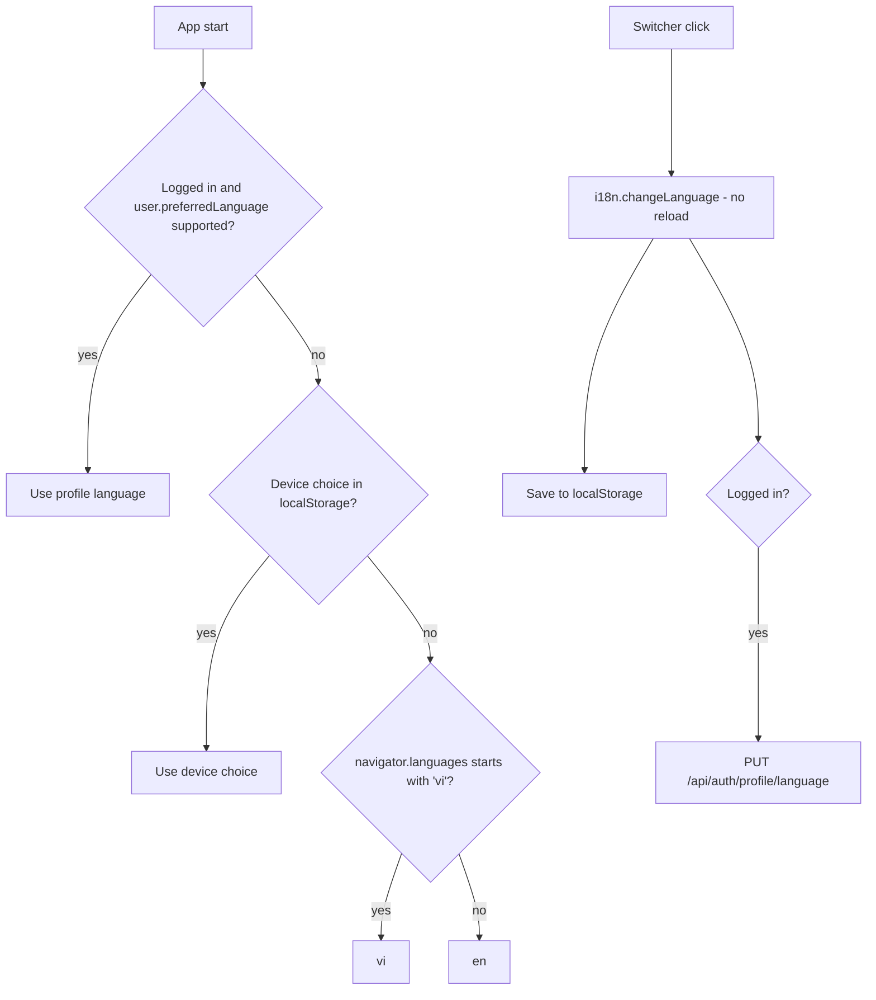

# Plan: Multilingual UI (English and Vietnamese)

## Summary

Add `i18next` + `react-i18next` to the UI, move every UI string into typed `en`/`vi` translation
files, and add a language switcher. Identity stores the choice as `User.PreferredLanguage`, sent
in the login reply, so the language follows the learner to any device.

## Affected services / areas

| Area | Change |
| --- | --- |
| Identity | `User.PreferredLanguage` column + migration, `PUT /api/auth/profile/language`, field on `UserDto`, optional field on register |
| WordBuddy.UI | i18n setup, `LanguageSwitcher`, language sync, string extraction in all ~78 `.tsx` files and the `*Ui.ts` label maps, localized dates, translated API errors |
| e2e | Pin `en-US` locale for existing UI suites; new `language.feature` (tester) |
| Content, Quiz, Progress, Notification | None |

## Language resolution



- Profile language is applied once per login (when the user id changes), not on every render.
- Logout keeps the current UI language.
- Unknown or unsupported codes fall back to `en`.

## Backend approach (Identity only)

Pattern to copy: `Features/Profile/Commands/UpdateDisplayName` and `UpdateProfileTimeZone`
(`develop-webapi` skill templates).

| Layer | Change |
| --- | --- |
| Domain `User` | `string? PreferredLanguage`, `const PreferredLanguageMaxLength = 10`, `static bool IsValidLanguageCode(string)`, `Result SetPreferredLanguage(string?)` (trim, lower-case, null clears) |
| Domain `UserErrors` | `User.InvalidLanguage` (validation) |
| Application | `UpdatePreferredLanguageCommand(Guid UserId, string? Language) : ICommand<UserDto>` + `Validator` + `Handler` under `Features/Profile/Commands/UpdatePreferredLanguage/` |
| Application `UserDto` | add `string? PreferredLanguage = null` (last optional param); map in `From` |
| Application register | `RegisterUserCommand` gets optional `string? PreferredLanguage`; validator checks format when present; handler calls `SetPreferredLanguage` |
| Infrastructure | `UserConfiguration`: `PreferredLanguage` `HasMaxLength(User.PreferredLanguageMaxLength)`; migration `AddPreferredLanguage` |
| Api | `ProfileController`: `PUT profile/language`, body `UpdateLanguageRequest { Language }`, returns `UserDto`, `ToProblemResult` on failure; `RegisterUserRequest` gets optional `PreferredLanguage` |

Rules:

- **Format check only on the server**: `^[a-z]{2,3}(-[a-z0-9]{2,8})?$`, max 10 chars. No `en`/`vi` list in the backend, so a third language needs no backend change. The UI decides what is supported.
- Handler does **not** publish `LearnerProfileUpdated` (no consumer needs the language).
- No caching (`GetCurrentUser` is not cached today). No rate-limit policy (same as other profile PUTs). No new JWT claim.
- Log user id only, never the value.
- **Child vs adult:** same endpoint, same rules, own account only (`[Authorize]`, id from token).

## Frontend approach

### i18n setup

| Item | Detail |
| --- | --- |
| Packages | `i18next`, `react-i18next` (no detector package; detection is ~15 lines) |
| `src/i18n/config.ts` | `SUPPORTED_LANGUAGES = [{ code: 'en', label: 'English' }, { code: 'vi', label: 'Tiếng Việt' }]`, `DEFAULT_LANGUAGE = 'en'`, `type LanguageCode`, `resources` map |
| `src/i18n/locales/en/*.ts` | Source of truth, one module per namespace: `common`, `nav`, `auth`, `profile`, `dashboard`, `lessons`, `vocabulary`, `review`, `challenges`, `groups`, `support`, `admin`, `errors` |
| `src/i18n/locales/vi/*.ts` | Same shape, typed `: TranslationOf<typeof en.x>` so a missing or extra key fails `tsc` |
| `src/i18n/i18next.d.ts` | `CustomTypeOptions` augmentation → `t('unknown.key')` fails `tsc` |
| `src/i18n/index.ts` | `initI18n()`, `resolveInitialLanguage()`, `applyLanguage(code)` (changeLanguage + `localStorage['wordbuddy-lang']` + `<html lang>`) |
| `main.tsx` | import `./i18n` before `App` |

Add a third language = new `locales/<code>/` folder + one entry in `SUPPORTED_LANGUAGES`.

TS modules instead of JSON: the compiler enforces key parity between `en` and `vi`. The UI has no
test runner, so `npm run build` is the check.

### Components and hooks

| Item | Detail |
| --- | --- |
| `components/LanguageSwitcher.tsx` | `<select>` (or two buttons) from `SUPPORTED_LANGUAGES`; label in its own language; `aria-label` translated. Calls `applyLanguage`, then the mutation when logged in. Inline error on save failure; UI language stays switched |
| Placement | `PublicLayout` (top of card) and `AppLayout` sidebar (above "Log out") |
| `api/auth.ts` | `updatePreferredLanguage(language: string): Promise<User>`; `RegisterPayload.preferredLanguage?` |
| `hooks/useProfile.ts` | `useUpdatePreferredLanguage()` → `setQueryData(CURRENT_USER_KEY)` + `authStore.updateUser` |
| `store/authStore.ts` | new `updateUser(user: User)` action, so the persisted user matches the server |
| `hooks/useLanguageSync.ts` | used once in `App`; when `user.id` changes and `user.preferredLanguage` is supported → `applyLanguage` |
| `types/index.ts` | `User.preferredLanguage: string \| null` |
| `RegisterPage` | sends `i18n.language` as `preferredLanguage` |

Server state stays in TanStack Query; the current language lives in i18next (not Zustand, not Query).

### String extraction rules

- Every JSX text, `placeholder`, `aria-label`, `title`, `alt`, button label, toast, empty/error state → `t('ns:key')`.
- Label maps (`statusLabel` in `supportUi.ts`, `groupUi.ts`, `challengeUi.ts`) become key maps, translated at render.
- Zod schemas move into `makeXSchema(t)` and are memoized on `i18n.language`, so validation messages switch at once.
- Plurals use i18next `count` (`_one`/`_other`); Vietnamese has one form.
- Dates and numbers: `formatDate`, `formatPlainDate`, `toLocale*` and `Intl.*` calls pass the current language (13 files today).
- **Not translated:** lesson content, vocabulary, grammar, daily phrases, quiz text, user-entered text, avatar emoji.

### API error messages

`problemMessage(error, fallback)` in `api/supportLinks.ts`:

```
problem.title (error code) has a key in errors:codes? → translated text
else language is 'en' and detail exists           → server detail (today's behaviour)
else                                               → fallback (already translated by caller)
```

Seed `errors:codes` with the Identity profile and auth codes (display name, date of birth,
password, time zone, alias, language, login failure). Other codes fall back to the translated
generic message in `vi`.

### Child vs adult

- Same switcher, same languages, same save path for both.
- Vietnamese copy for child-visible screens (nav, review, dashboard, lessons, gate) uses short, simple words.
- No new child data is shown or logged.

## Data / migration notes

- Identity migration `AddPreferredLanguage`: nullable `nvarchar(10)` on `Users`. No backfill (null = follow device/browser).
- Run per service: `make k8s-migrate SERVICE=identity` (ask-gated).

## Open questions

1. **Library choice** — plan adds `i18next` + `react-i18next` (standard, typed keys, plurals). Alternative: a hand-rolled typed dictionary, no dependency. Write an ADR? Plan assumes yes (`docs/adr/NNNN-ui-i18n.md`).
2. **Switcher before login** — plan puts it on `/login` and `/register` too, and a device choice (localStorage) wins over the browser language. The proposal only says "browser language before login". OK?
3. **Server allow-list** — plan validates format only, so a third language needs no backend change. Prefer a strict `en`/`vi` allow-list instead?
4. **Vietnamese copy review** — who checks the `vi` texts (tone for children)? Plan assumes Sam reviews in `/review`.
5. **Server-generated text** — `User.PublicName` returns "Child learner" and some `ProblemDetails.detail` strings are English. Plan does not change backend text; unmapped errors show a translated generic message in `vi`. Accept as known limit?
6. **`WordBuddy.UI/CLAUDE.md` rule** — add "no hard-coded UI text, use `t()`" to the frontend conventions. CLAUDE.md is ask-gated; the coder proposes the exact text to Sam.
7. **Size** — string extraction touches ~78 `.tsx` files. See scope suggestion: split admin/moderator screens into a follow-up.
8. Beyond the goal (not planned): send `preferredLanguage` in `LearnerProfileUpdated` for future localized notifications/emails.
