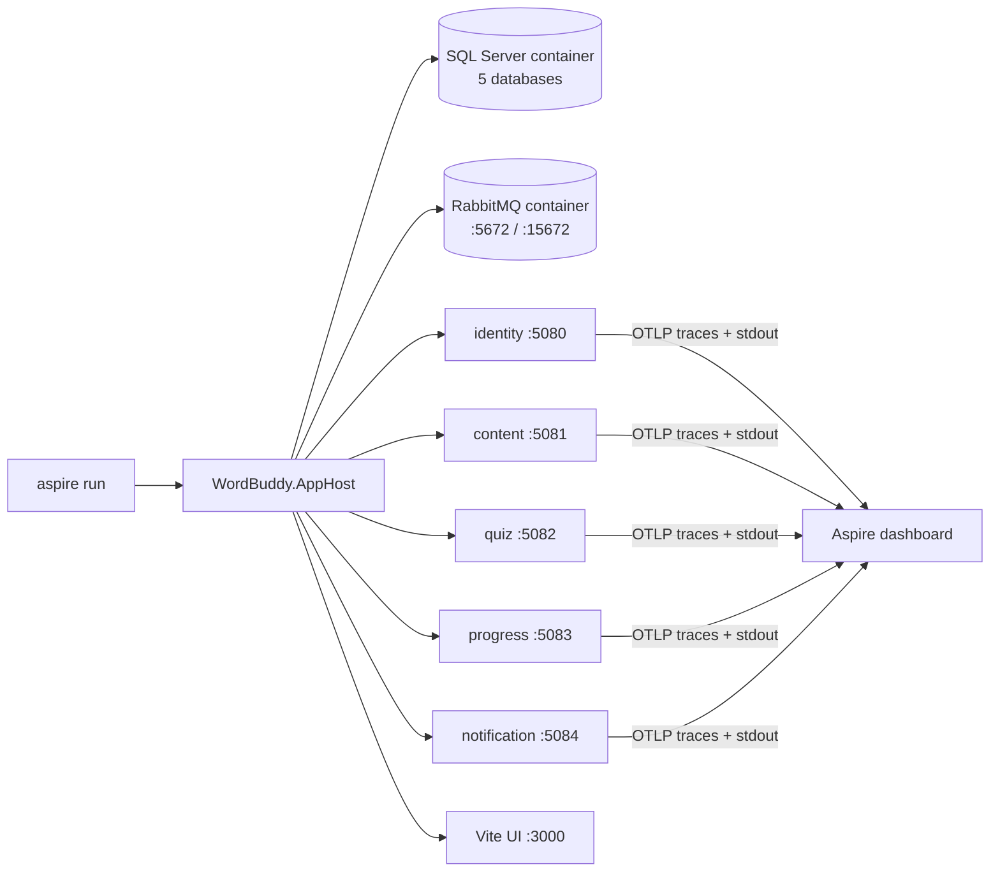

# Plan: Adopt .NET Aspire for local orchestration

## Summary

Add one orchestration-only AppHost at `WordBuddy/aspire/WordBuddy.AppHost/`, as ADR 0007 describes.
It wires the 5 APIs by path, maps the existing config keys through environment variables, and pins
the existing dev ports. With that, service code, the Vite proxy and the e2e config stay unchanged.
Migrations: keep the existing Development startup migration. There is no migrator worker and no
manual step.

## Affected services / areas

| Area | Change |
| --- | --- |
| `WordBuddy/aspire/` (new) | `WordBuddy.Aspire.slnx`, `nuget.config`, `WordBuddy.AppHost`, `WordBuddy.AppHost.Tests` |
| Identity, Content, Quiz, Progress, Notification | **None.** No code, csproj, appsettings or launchSettings change |
| `WordBuddy.UI` | **None.** The Vite proxy targets (5080–5083) stay as they are |
| `docker-compose.yml`, `Makefile`, `k8s/`, `.env.example` | **None** |
| Docs | `WordBuddy/README.md`, `docs/adr/0007` (decision + status), the living spec. `WordBuddy/CLAUDE.md` gets a proposed change only, because the file is ask-gated |
| `.gitignore` | Ignore the AppHost local media folder |

Child vs adult: **no difference.** This is developer tooling. Seeded child and adult accounts and
all child restrictions stay as they are, because the services and their seeders do not change.

## Backend approach

### Findings that shape the design

| Finding | Source | Effect on the plan |
| --- | --- | --- |
| Identity, Content and Quiz call `DataSeeder.MigrateAndSeedAsync` in Development. Progress calls `MigrateAsync` in Development | `*.Api/Extensions/WebApplicationExtensions.cs` | Migrations already run on startup. See the decision below |
| launchSettings ports are not aligned: Identity 5080, Content 5029, Quiz 5009, Progress 5178, Notification 5041 | `Properties/launchSettings.json` | The AppHost ignores launch profiles and pins 5080–5084 itself |
| Vite proxy and e2e use 5080–5084, and e2e uses `Public` = `:3000` | `vite.config.ts`, `e2e/api/.../appsettings.json` | The pinned ports keep both unchanged. The UI is pinned to 3000 |
| OTel uses `OpenTelemetry:OtlpEndpoint`, else the `OTEL_EXPORTER_OTLP_*` env vars. **Tracing only**, no OTLP logs and no metrics | `OpenTelemetryExtensions.cs` | The dashboard gets traces plus console logs (stdout), with no code change. It gets no structured logs and no metrics. See Open questions |
| `RabbitMqOptions` has `Host` but **no `Port`** | `MessagingOptions.cs` | The RabbitMQ AMQP port is pinned to 5672 |
| `FileStorage:BasePath` defaults to `""` (the process working directory) | `FileStorageSettings.cs` | The AppHost sets the path to a gitignored local folder |
| `Autofill:Claude:ApiKey` comes from env only. Content has no `UserSecretsId` | `AutofillClientSettings.cs` | An optional secret parameter, set only if it has a value |
| `WordBuddy/nuget.config` lists the `github-wordbuddy` feed, which needs a PAT | `nuget.config` | The `aspire/` folder gets its own `nuget.config` with `<clear/>` and nuget.org only |

### Migration decision (open question from the proposal)

**Recommendation: keep the existing Development startup migration. Add no migrator worker and no
manual `dotnet ef` step.**

| Option | Code change | ADR 0001 | Verdict |
| --- | --- | --- | --- |
| A. Migrator worker per service | 4 new projects. They must reference each service's `Infrastructure` (inside the service, which grows its solution) or reference it from `aspire/` (a project reference, which breaks ADR 0001) | At risk | Rejected |
| B. Manual `dotnet ef database update` | None, but an extra manual step on every new migration, and a dynamic SQL port to look up | OK | Fallback only |
| **C. Existing `MigrateAsync` in Development** | None. Aspire runs each API with `ASPNETCORE_ENVIRONMENT=Development`. `WaitFor(db)` ensures SQL Server is ready first | OK | **Chosen** |

Reasons:

- It already works this way under compose. Aspire changes only who starts the process.
- It meets "no change to service code" and adds no project.
- Each service owns its own schema at startup, so a service that moves to its own repo keeps
  this behaviour.

Option B stays documented as a fallback (connection string copied from the dashboard). ADR 0007
gets this decision added to its Consequences.

### AppHost project

- `WordBuddy/aspire/WordBuddy.AppHost/WordBuddy.AppHost.csproj`, using `Sdk="Aspire.AppHost.Sdk/<13.x>"`,
  `net10.0` (from `global.json`). Pin the current stable Aspire version at `/code` time.
- Packages: `Aspire.Hosting.SqlServer`, `Aspire.Hosting.RabbitMQ`, `Aspire.Hosting.JavaScript`
  (`AddViteApp`).
- **No `<ProjectReference>`** to anything under `src/`.
- Class-based `Program` with `Main`, no top-level statements, XML docs. This matches the backend
  convention.
- `nuget.config` in `WordBuddy/aspire/`: `<clear/>` + nuget.org only. The AppHost needs no
  `WordBuddy.Shared.*` package. Each service still restores through its own `nuget.config` when
  Aspire runs `dotnet run` on it.

### Resource wiring

| Resource | Aspire call | Key settings |
| --- | --- | --- |
| `sql` | `AddSqlServer("sql", password: saPassword)` | `.WithDataVolume()`, `ContainerLifetime.Persistent`. Host port stays dynamic |
| `identitydb` … `notificationdb` | `sql.AddDatabase("<x>db", "WordBuddy<X>")` | Same DB names as `sqlserver-init` in compose |
| `rabbitmq` | `AddRabbitMQ("rabbitmq", rmqUser, rmqPassword, port: 5672)` | `.WithManagementPlugin(port: 15672)`, data volume, persistent |
| `identity` | `AddProject("identity", "../../src/Services/Identity/WordBuddy.Identity.Api/WordBuddy.Identity.Api.csproj", launchProfileName: null)` | `.WithHttpEndpoint(port: 5080)` |
| `content` | same pattern | `:5081`, `FileStorage__BasePath` |
| `quiz` | same pattern | `:5082`. No RabbitMQ, the same as compose |
| `progress` | same pattern | `:5083`, `Services__Content__BaseUrl` = content endpoint |
| `notification` | same pattern | `:5084`. JWT only, the same as compose |
| `ui` | `AddViteApp("ui", "../../../WordBuddy.UI")` | Port `3000`, `WaitFor` the 4 APIs the proxy uses |

Environment per API. The keys mirror `docker-compose.yml` exactly, so both run paths stay aligned:

| Env var | Identity | Content | Quiz | Progress | Notification |
| --- | --- | --- | --- | --- | --- |
| `ASPNETCORE_ENVIRONMENT=Development` | ✔ | ✔ | ✔ | ✔ | ✔ |
| `ConnectionStrings__DefaultConnection` (`WithReference(db, "DefaultConnection")`) | ✔ | ✔ | ✔ | ✔ | — |
| `Jwt__Secret`, `Jwt__Issuer` | ✔ | ✔ | ✔ | ✔ | ✔ |
| `Jwt__ExpiryMinutes` | ✔ | — | — | — | — |
| `Messaging__RabbitMq__Host/Username/Password` | ✔ | ✔ | — | ✔ | — |
| `SupportLinks__UnlinkOverrideWaitDays` | ✔ | — | — | — | — |
| `FileStorage__BasePath` | — | ✔ | — | — | — |
| `Autofill__Claude__ApiKey` (only if set) | — | ✔ | — | — | — |
| `Services__Content__BaseUrl` | — | — | — | ✔ | — |

- `WaitFor(db)` on each API that has a database. `WaitFor(rabbitmq)` on Identity, Content and Progress.
- `.WithHttpHealthCheck("/health/ready")` on every API, so the dashboard shows "Healthy".
- Telemetry: Aspire injects `OTEL_EXPORTER_OTLP_ENDPOINT`, `_PROTOCOL` and `_HEADERS`. The services
  pick these up because `OpenTelemetry:OtlpEndpoint` is unset in `appsettings.json`.

### Parameters (secrets)

Stored in AppHost user-secrets (`UserSecretsId` in the AppHost csproj), as `Parameters:<name>`. The
dashboard prompts for any missing value.

| Parameter | Secret | Default |
| --- | --- | --- |
| `sql-password` | yes | none |
| `jwt-secret` | yes | none (≥ 32 chars) |
| `jwt-issuer` | no | `WordBuddy` |
| `jwt-expiry-minutes` | no | `60` |
| `rabbitmq-user` | no | `wordbuddy` |
| `rabbitmq-password` | yes | none |
| `claude-api-key` | yes | optional, unset = Autofill AI off (the same as today) |

Nothing is read from `.env`. No secret goes into `appsettings.json` of the AppHost or into git.

### Messaging, caching, endpoints

None. No new commands, queries, endpoints, events or cache keys. The `develop-webapi` skill does
not apply.

## Frontend approach

None in `WordBuddy.UI/src` or `vite.config.ts`. The AppHost starts Vite (`npm run dev`) on port 3000.
The existing proxy reaches the APIs on their pinned ports. Run `npm install` once first, or turn on
the integration's install option.

## Data / migration notes

- No new EF Core migration.
- Schema is applied by each service's existing Development startup `MigrateAsync`. This also seeds
  Identity, Content and Quiz.
- The SQL and RabbitMQ volumes are separate from the compose volumes. A first `aspire run` starts
  with fresh seeded databases.
- If `sql-password` changes after the volume exists, the old volume no longer accepts it. Delete
  the volume (documented).

## Prerequisites (documented in README)

`make pack-shared` (local feed for service restore) → Aspire CLI installed →
`dotnet dev-certs https --trust` → Docker Desktop running → set parameters → `aspire run` from
`WordBuddy/aspire/`.

**Do not run compose and Aspire at the same time.** Both bind 5080–5084, 5672 and 15672.

## Open questions

1. **Metrics and structured logs.** The proposal Goal says "logs, traces and metrics". With no
   service-code change, the dashboard shows **traces + console logs only**. The shared OTel helper
   exports neither metrics nor OTLP logs. Plan: accept this for WB-61, and add OTLP metrics and
   logs in `WordBuddy.Shared.Infrastructure` in a separate proposal. Sam, please confirm.
2. **Dashboard resource mapping.** `AddService(serviceName)` sets `WordBuddy.Identity` and creates
   its own instance id, so traces may show as a separate dashboard entry instead of under the
   `identity` resource. The traces are still visible. Verify in `/code`, and record the result in
   the README. The fix is a shared-library change (out of scope).
3. **SQL host port.** Dynamic (Aspire default), so it does not clash with other local SQL. Pin it
   to 1433 only if Sam wants fixed tool connections.
4. **e2e against Aspire.** The pinned ports let `e2e/api` and `e2e/ui` run against `aspire run`
   unchanged. Should `/test` switch to Aspire as its default stack? This plan does not change the
   tester flow.

## Scope suggestions (not in this plan)

- OTLP metrics + logs in `WordBuddy.Shared.Infrastructure` (see Open question 1).
- Align each service's `launchSettings.json` port with 5080–5084, so a plain `dotnet run` matches.
- Add a `make aspire` convenience target (kept out because make targets stay unchanged).
