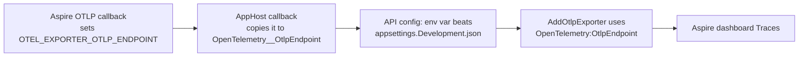

# Plan: Fix Aspire dashboard traces and accept ADR 0007

## Summary

The AppHost copies the OTLP endpoint that Aspire injects into `OpenTelemetry__OtlpEndpoint` for
each API. An environment variable beats `appsettings.Development.json`, so traces reach the
dashboard on every machine. Resource mapping is **documented, not changed**, because the fix needs
a change under `src/Shared`. ADR 0007 becomes `accepted`, and the README and living spec describe
the verified behaviour.

## Affected services / areas

| Area | Change |
| --- | --- |
| `WordBuddy/aspire/WordBuddy.AppHost/Program.cs` | New `WithDashboardOtlpEndpoint()` step in `AddApi` |
| `WordBuddy/aspire/WordBuddy.AppHost.Tests/` | Model tests for the new key and value; one integration test with a fake OTLP receiver |
| `docs/adr/0007-aspire-local-orchestration.md` | `Status: accepted`; Telemetry row and Consequences updated (coder) |
| `WordBuddy/README.md` "Aspire (local dev)" | Verified trace behaviour, no "not verified" text (coder) |
| `docs/features/WB-61_...md` | "Known gap" resolved (tester at `/test`, on the allowlist) |
| `src/`, `WordBuddy.UI/`, `docker-compose.yml`, `Makefile`, `k8s/` | **None** |

Child vs adult: **no difference.** Developer tooling only. No service code, policy or seeder changes.

## Backend approach

### Findings

| Finding | Source | Effect |
| --- | --- | --- |
| The helper reads `configuration["OpenTelemetry:OtlpEndpoint"]` first. When set, it sets `options.Endpoint` | `OpenTelemetryExtensions.cs:31-35` | The AppHost must set this key, not only `OTEL_EXPORTER_OTLP_ENDPOINT` |
| ASP.NET Core config order: env vars override `appsettings.{Environment}.json` | Default host builder | `OpenTelemetry__OtlpEndpoint` from the AppHost wins over Sam's local file |
| Protocol and headers (`OTEL_EXPORTER_OTLP_PROTOCOL`, `_HEADERS`, incl. the dashboard API key) still come from env when only `Endpoint` is set in code | OTel .NET `OtlpExporterOptions` | Copying the endpoint only is enough. Auth keeps working |
| An `Endpoint` set in code is used **as is**. For `http/protobuf` the SDK does not append `/v1/traces` | OTel .NET exporter behaviour | The copy must append `/v1/traces` when the protocol is `http/protobuf`. gRPC (the `aspire run` default) needs no path |
| Aspire's OTLP env callback is added inside `AddProject`. Callbacks run in annotation order | Aspire `WithOtlpExporter` | A callback added after `AddProject` can read the injected value |
| `ConfigureResource(r => r.AddService(serviceName))` runs after the env detectors. Later attributes win on merge. It also generates a new `service.instance.id` | `OpenTelemetryExtensions.cs:21`, OTel `ResourceBuilder` | It overrides Aspire's `OTEL_SERVICE_NAME` and `service.instance.id`. No AppHost setting can change this |

### AppHost change

Add one private extension in `Program.cs` and call it from `AddApi`, after `AddProject`:

| Step | Behaviour |
| --- | --- |
| 1 | `WithEnvironment(context => ...)` callback |
| 2 | Read `context.EnvironmentVariables["OTEL_EXPORTER_OTLP_ENDPOINT"]`. If absent (no dashboard), do nothing |
| 3 | If `OTEL_EXPORTER_OTLP_PROTOCOL` is `http/protobuf`, value = endpoint trimmed of `/` + `/v1/traces`. Else value = endpoint |
| 4 | Set `OpenTelemetry__OtlpEndpoint` = value |

- Keep the value type as found (string or `ReferenceExpression`/provider). If it is not a plain
  string, set the same object for gRPC. For HTTP build a `ReferenceExpression`. The coder checks
  the runtime type in Aspire 13.x and handles it.
- XML doc comment on the new method. It states why the method exists: a local
  `appsettings.Development.json` would otherwise override the injected endpoint.
- Applies to all 5 APIs, because every API goes through `AddApi`.

Messaging, caching, endpoints, migrations: none. The `develop-webapi` skill does not apply.

### Trace-to-resource mapping (open question from the proposal)

**Recommendation: document the `WordBuddy.<Service>` naming. Do not try to map in the AppHost.**

| Option | Works? | Constraint | Verdict |
| --- | --- | --- | --- |
| A. Set `OTEL_SERVICE_NAME` / `OTEL_RESOURCE_ATTRIBUTES` in the AppHost | **No.** Aspire already sets both. `AddService(serviceName)` overrides them, and creates its own instance id | AppHost only | Rejected: no effect |
| B. Rename resources to `WordBuddy.Identity` | **No.** Resource names allow no `.`; the instance id still differs. Breaks tests, README, `CreateHttpClient("identity")` | AppHost only | Rejected |
| C. Change the shared helper (e.g. `AddService` only when `OTEL_SERVICE_NAME` is unset) | Yes | Change under `src/Shared` + package bump in 5 services | Out of scope → scope suggestion |
| **D. Document `WordBuddy.<Service>`** | Yes | AppHost only | **Chosen** |

Reasons:

- Only option D meets the "AppHost only" rule and has an effect.
- `WordBuddy.<Service>` is the same name Jaeger shows under compose and kind. One name on all run paths.
- Traces are complete and searchable. Only grouping differs: Traces are under `WordBuddy.<Service>`,
  console logs and health are under `identity`, `content`, ...

## Frontend approach

None.

## Data / migration notes

None.

## Verification (for `/test`)

| Check | How | Proves |
| --- | --- | --- |
| Model: key present | `ExpectedKeys` theory gets `OpenTelemetry__OtlpEndpoint` for all 5 APIs. `AppHostFixture.BaseArgs` gets a throwaway dashboard OTLP URL (`ASPIRE_DASHBOARD_OTLP_ENDPOINT_URL=http://localhost:18889`) | Success criterion "AppHost test asserts the key for every API" |
| Model: value matches (gRPC) | `OpenTelemetry__OtlpEndpoint` equals `OTEL_EXPORTER_OTLP_ENDPOINT` | No drift between the 2 keys |
| Model: value for HTTP | With only the HTTP dashboard URL set, value ends in `/v1/traces` | Path handling |
| Model: no dashboard | No OTLP config → key absent | No broken endpoint when the dashboard is off |
| Integration (automated) | `AppHost_Run_TracesReachOtlpEndpoint`: test hosts a fake OTLP/HTTP receiver (Kestrel, free port) that counts `POST /v1/traces`. Points the AppHost at it via the HTTP dashboard OTLP URL. Starts the stack, calls `/health/ready` on each API, waits until each API sent at least one export | Traces leave each process for the injected endpoint, not :4317 |
| Manual dashboard check (tester, Sam's machine with local `appsettings.Development.json`) | `aspire run`, open the dashboard (Playwright, as in WB-61), call each API, open Traces | Real gRPC path, real override case. 5 entries `WordBuddy.Identity` ... `WordBuddy.Notification` |

- The fake receiver needs no protobuf decode. Protobuf stores strings as raw UTF-8, so it searches
  each request body for `WordBuddy.<Service>`. The test asserts all 5 names arrive within a timeout
  (the batch exporter flushes about every 5 s).
- The test uses `http/protobuf` so it needs no gRPC server. The gRPC path is covered by the
  manual dashboard check.
- If the testing builder does not run Aspire's OTLP callback (dashboard disabled), the coder sets
  the needed config keys in the test. Record the finding in the test's XML doc.

## Open questions

1. **Resource mapping.** Sam: confirm option D. Option C (shared helper fix) is listed as a scope
   suggestion, not part of this change.
2. **Integration test run time.** The new test starts the full stack a second time (about 3 min).
   Plan: keep it a separate `[Fact]` under `Category=Integration`. Merging it into
   `AppHost_Run_AllApisReachHealthy` would save time but mix two concerns.
3. **Unrelated local edits.** The working tree has uncommitted changes in
   `Content.Infrastructure.csproj` and `e2e/api/...Tests.csproj`. They are not part of this change;
   `/code` must not stage them.

## Scope suggestions (not in this plan)

- Shared helper: skip `AddService(serviceName)` when `OTEL_SERVICE_NAME` is set, or pass
  `autoGenerateServiceInstanceId: false` — maps traces to Aspire resources.
- OTLP metrics + logs in `WordBuddy.Shared.Infrastructure` (already listed in WB-61).
