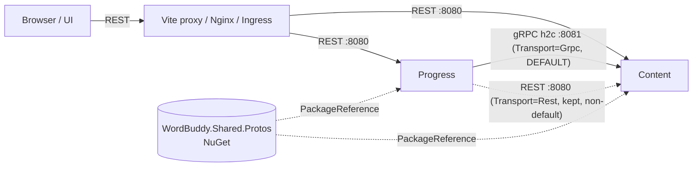

# Plan: gRPC for internal service calls

## Summary

gRPC becomes the **default** channel for the only internal synchronous call (Progress → Content,
"get senses by ids"), per proposal v1.2. Content hosts a gRPC service on a second, HTTP/2-only port,
next to REST. Progress uses gRPC by default in every environment; REST stays selectable with one
config switch. The `.proto` ships in a new versioned NuGet package, `WordBuddy.Shared.Protos`.
Nothing is deleted.



## Affected services / areas

| Area | Change |
| --- | --- |
| `src/Shared` | New package `WordBuddy.Shared.Protos` 1.0.0 (`.proto` + generated stubs) |
| Content | gRPC server `ContentSenses`, gRPC health service, second Kestrel endpoint (HTTP/2) |
| Progress | `ContentSenseGrpcClient`, transport switch, gRPC readiness check |
| Aspire AppHost | Content `grpc` endpoint (5091), new env keys, model tests |
| docker compose / Dockerfile | Content listens on 8080 (REST) + 8081 (gRPC); Progress env |
| k8s | `content-api` Service/Deployment get port `grpc` 8081; Progress env. Ingress unchanged |
| Docs | ADR 0008, Content/Progress README, ports table |
| UI | None |

## Inventory of internal synchronous calls

Searched every service for `AddHttpClient` / `Services:*` config.

| Caller → callee | Client | Endpoint | In scope |
| --- | --- | --- | --- |
| Progress → Content | `ContentSenseClient` (typed `HttpClient`) | `GET /api/vocabulary/senses?ids=` | Yes |
| Progress → Content | `ContentHealthCheck` (named client) | `GET /health` | Yes (gRPC health variant) |
| Content → FreeDictionary / Claude / audio URLs | `FreeDictionaryClient`, `ClaudeSenseGenerator`, `HttpAudioDownloader` | external | No (not internal) |

Identity, Quiz, Notification make no synchronous calls to other services.

## Key decisions

| Topic | Decision | Why |
| --- | --- | --- |
| Where `.proto` lives | New package `WordBuddy.Shared.Protos` in `src/Shared/`, `GrpcServices="Both"`, deps `Google.Protobuf` + `Grpc.Core.Api` only. `.proto` files also packed as content. | Same model as other shared code (ADR 0001): versioned NuGet, no project reference. Keeps `WordBuddy.Shared.Contracts` dependency-free (its description says so). One typed contract, no copied DTOs. |
| Rejected: in `Shared.Contracts` | — | Adds protobuf/gRPC deps to every MassTransit consumer; mixes two contract kinds. |
| Rejected: copy `.proto` per service | — | Recreates the drift problem the proposal wants to fix. |
| Transport choice | `Services:Content:Transport` = `Grpc` \| `Rest`, read once at startup in `AddContentClient`. **Default `Grpc`** — in code (`ContentOptions`), `appsettings.json`, Aspire, compose and kind. `Rest` only when set explicitly. No automatic runtime fallback. | Proposal v1.2: gRPC is the default; REST is kept and works when selected. One env var switches back. |
| Auth | Reuse `ForwardBearerTokenHandler` on the gRPC client: caller's JWT goes as `authorization` metadata. Content's gRPC service uses the **same** `[Authorize]` + `[Authorize(Policy = SupportLinkPolicies.ChildHasSupporter)]` as `PersonalVocabularyController`. User id and `AgeGroup` come from the JWT, never from the message. | Same security as REST today; child filter cannot be bypassed or spoofed. |
| Ports | Content: REST endpoint `Http` (HTTP/1.1, unchanged) + new endpoint `Grpc` (`Protocols=Http2`, cleartext h2c). Configured through `Kestrel:Endpoints:*`. | Cleartext `Http1AndHttp2` cannot negotiate HTTP/2, so gRPC needs its own HTTP/2-only port. No TLS internally (same as REST today). |
| Port numbers | Dev/Aspire: REST 5081, gRPC **5091**. Containers: REST 8080, gRPC **8081**. | Mirrors existing pinned ports; +10 is easy to remember. |
| Exposure | k8s: ClusterIP port `grpc` 8081 only, **no Ingress rule**. Compose: `expose: 8081`, not published to the host. | Internal-only channel. |
| Resilience | `AddGrpcClient<ContentSenses.ContentSensesClient>` (uses `IHttpClientFactory`) + same `AddStandardResilienceHandler` settings as REST. `RpcException` → `Content.Unavailable`. | Same timeouts / circuit breaker; same failure contract for handlers. |
| Caching | Extract the existing session cache logic (`progress:session-senses:{sessionId}`) into one internal helper used by both clients. Key and expiry unchanged. | No duplicated cache code; behaviour identical for either transport. |
| Health | Content: `AddGrpcHealthChecks` + `MapGrpcHealthChecksService()` (standard `grpc.health.v1`), liveness semantics like `/health`. Progress: new `ContentGrpcHealthCheck` (`"content-grpc"`, `Degraded`, ready tag), registered only when `Transport=Grpc`. REST `ContentHealthCheck` stays. | Readiness reflects the channel actually in use. |
| OpenTelemetry | No shared-library change. Inbound gRPC is covered by `AddAspNetCoreInstrumentation` (`rpc.*` tags); outbound by `AddHttpClientInstrumentation` because the gRPC client runs on `IHttpClientFactory`. Verify in Aspire dashboard. | Avoids a `Shared.Infrastructure` repack. |
| Rate limiting | None on the gRPC method (REST `senses` has no policy either). | Parity. |
| ADR | **Yes — ADR 0008** "gRPC for internal synchronous calls". | New inter-service protocol + new shared package + new port convention. |

## Backend approach

### `WordBuddy.Shared.Protos` (new, `src/Shared/`)

- `Protos/content/v1/content_senses.proto`, package `wordbuddy.content.v1`, `csharp_namespace = "WordBuddy.Shared.Protos.Content.V1"`.

```proto
service ContentSenses {
  rpc GetSensesByIds (GetSensesByIdsRequest) returns (GetSensesByIdsReply);
}
message GetSensesByIdsRequest { repeated string sense_ids = 1; }   // 1–100 GUIDs
message SenseReview {
  string sense_id = 1; string word = 2; string definition = 3;
  optional string example = 4; optional string audio_url = 5;
  optional string image_url = 6; optional string personal_context = 7;
}
message GetSensesByIdsReply { repeated SenseReview senses = 1; }
```

- Add to `WordBuddy.Shared.slnx` and `make publish-shared` / the local `dotnet pack` list.

### Content

- `Api` references `WordBuddy.Shared.Protos`, `Grpc.AspNetCore`, `Grpc.AspNetCore.HealthChecks`.
- `Api/Grpc/ContentSensesGrpcService.cs` : `ContentSenses.ContentSensesBase` — presentation layer, like a controller.
  - Parses ids (bad GUID → `InvalidArgument`), calls the existing `IQueryHandler<GetSensesByIdsQuery, IReadOnlyList<SenseReviewDto>>` with `User.GetUserId()` / `User.GetAgeGroup()` from `context.GetHttpContext().User`.
  - Maps `Result` failures: `Validation` → `InvalidArgument`, `NotFound` → `NotFound`, else `Internal`. One small mapper, like `ToProblemResult`.
  - No new handler, query, entity or validator — the application layer is reused as is.
- `Program`/`ServiceCollectionExtensions`: `AddGrpc()`, `AddGrpcHealthChecks()`; `WebApplicationExtensions`: `MapGrpcService<ContentSensesGrpcService>()`, `MapGrpcHealthChecksService()`.
- `appsettings.json`: `Kestrel:Endpoints:Http:Url = http://localhost:5081`, `Kestrel:Endpoints:Grpc:Url = http://localhost:5091`, `Kestrel:Endpoints:Grpc:Protocols = Http2`.
- `Dockerfile`: replace `ASPNETCORE_URLS` with `Kestrel__Endpoints__Http__Url=http://+:8080`, `Kestrel__Endpoints__Grpc__Url=http://+:8081`, `Kestrel__Endpoints__Grpc__Protocols=Http2`; `EXPOSE 8080 8081`.

### Progress

- `Infrastructure` references `WordBuddy.Shared.Protos`, `Grpc.Net.ClientFactory`, `Grpc.HealthCheck` (client side of `grpc.health.v1`).
- `ContentOptions`: add `Transport` (`ContentTransport` enum `Rest`/`Grpc`, default `Grpc`) and `GrpcUrl` (default `http://localhost:5091`).
- `ContentClient/SessionSenseCache.cs` (internal): get/set of `progress:session-senses:{sessionId}`, moved out of `ContentSenseClient`. `ContentSenseClient` keeps its public behaviour.
- `ContentClient/ContentSenseGrpcClient.cs` : `IContentSenseClient` — cache → chunk of 100 ids → `GetSensesByIdsAsync` → map to `ContentSenseDto` → cache. Logs ids/counts only.
- `ContentClient/ContentGrpcHealthCheck.cs` — `Health.HealthClient.CheckAsync`, 3 s deadline; `Serving` → Healthy, else Unhealthy.
- `AddContentClient`: always register the REST health named client; then branch on `Transport`:
  - `Rest` → today's `AddHttpClient<IContentSenseClient, ContentSenseClient>` (unchanged).
  - `Grpc` → `AddGrpcClient<ContentSenses.ContentSensesClient>` + `ForwardBearerTokenHandler` + standard resilience; `AddScoped<IContentSenseClient, ContentSenseGrpcClient>`; gRPC health client.
- `Program.cs`: add `ContentGrpcHealthCheck` only when `Transport=Grpc`.

### Orchestration

| Env | Content | Progress |
| --- | --- | --- |
| Aspire | 2nd endpoint `grpc` port 5091, transport `http2`. Pass `Kestrel__Endpoints__Http__Url` / `Grpc__Url` / `Grpc__Protocols` built from each endpoint's **target port** (Kestrel config overrides `ASPNETCORE_URLS`). | `Services__Content__GrpcUrl` = `content.GetEndpoint("grpc")`, `Services__Content__Transport=Grpc` |
| compose | `expose: ["8081"]` (Kestrel env comes from the Dockerfile) | `Services__Content__GrpcUrl: http://content-api:8081`, `Services__Content__Transport: Grpc` |
| kind | Deployment `containerPort 8081 name grpc`; Service port `grpc` 8081 `appProtocol: kubernetes.io/h2c`. Ingress unchanged. | same two env vars, `http://content-api:8081` |

## Child vs adult behaviour

- No visible change for either group, on either transport.
- The gRPC path **must** keep the child filter: same `[Authorize]` + `ChildHasSupporter` policy, `AgeGroup` from the forwarded JWT, `Sense.IsVisibleTo` via the reused query handler.
- Tests cover Adult, Child-with-supporter (child-visible senses only) and Child-without-supporter (`PermissionDenied`).

## Frontend approach

None. Public REST endpoints and the UI do not change.

## Data / migration notes

None.

## Open questions

1. ~~Default transport~~ — **decided by proposal v1.2:** `Grpc` everywhere; `Rest` is selectable, non-default.
2. **No automatic gRPC → REST fallback** at runtime. Switching is a config change + restart. Confirm.
3. **New package `WordBuddy.Shared.Protos`** instead of extending `WordBuddy.Shared.Contracts`. Confirm the name.
4. **Aspire endpoints:** plan keeps Aspire proxying and feeds Kestrel the target ports. If that proves fragile, fallback is `isProxied: false` on Content's two endpoints. `/code` may pick the fallback; it must keep REST on 5081.
5. **`CLAUDE.md` updates are ask-gated.** `WordBuddy/CLAUDE.md` lists the shared packages and ports; `/code` proposes the exact text to Sam instead of editing.
6. **Plaintext h2c** inside the cluster/compose network, same as REST today. TLS/mTLS is out of scope.
7. Beyond scope (see final report): k8s native gRPC probes, service identity tokens instead of user-token forwarding, proto lint/breaking-change check in CI, gRPC reflection for dev tooling.
