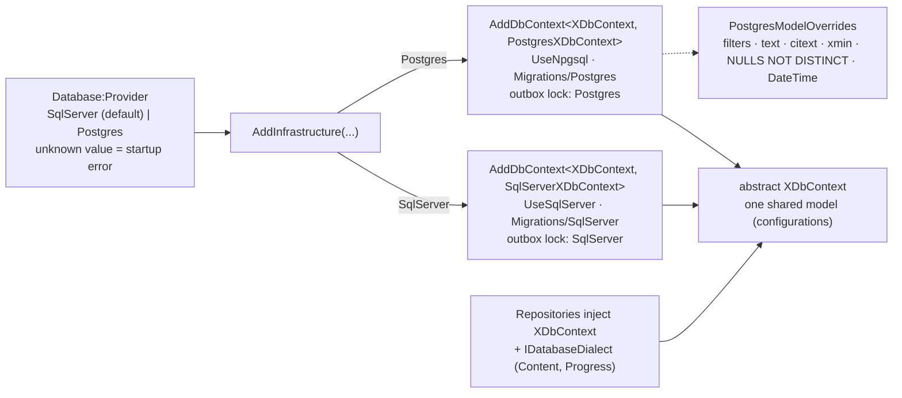

# Plan: Add PostgreSQL as an alternative persistence provider

## Summary

Each data service (Identity, Content, Quiz, Progress) gets a `Database:Provider` switch: `SqlServer` (default) or `Postgres`. One shared EF model per service, two thin provider subclasses that own their migrations. All changes stay inside each service's Infrastructure, plus one small optional parameter in `WordBuddy.Shared.Infrastructure` for the MassTransit outbox lock syntax. This follows ADR 0009, with three corrections listed in Key decisions.



## Affected services / areas

| Area | Change |
| --- | --- |
| `WordBuddy.Shared.Infrastructure` | `AddWordBuddyMessaging` gets optional `OutboxLockProvider` (default `SqlServer`). Version 1.2.0 → 1.3.0 |
| Identity | Provider switch, context split, Postgres overrides (filters, `citext`), Postgres `InitialCreate` |
| Content | Same, plus `IDatabaseDialect` (error codes, `OUTPUT`/`RETURNING`), savepoint for guarded delete, `ExecuteDeleteAsync` for orphan deletes, upper-case search pattern |
| Quiz | Provider switch, context split, `nvarchar(max)` override, first integration tests |
| Progress | Same as Content, plus `xmin` concurrency token and `FOR UPDATE` row lock for challenge joins |
| Aspire AppHost | `db-provider` parameter; Postgres container when set |
| docker compose | New `docker-compose.postgres.yml` override; `make up-postgres` |
| k8s | New `k8s/postgres/` manifests; `make k8s-apply DB=postgres` |
| Makefile | Provider-aware `migrate` / `k8s-migrate` (`--context`) |
| Skills / docs | `ef-migration` skill (two migrations), ADR 0009 → accepted, service READMEs, `.env.example`, `secret.yaml.example` |
| e2e | `LearnerWordMessagingTests` uses `sqlcmd`; tester makes it provider-aware |
| UI | None |
| Notification | None (no database) |

## SQL Server-specific code found

| Spot | Service | Postgres handling |
| --- | --- | --- |
| `UseSqlServer` in `AddInfrastructure` + design-time factory | all 4 | Branch on provider; one factory per subclass |
| `outbox.UseSqlServer()` in `MessagingExtensions` | Shared | `UsePostgres()` when `OutboxLockProvider.Postgres` |
| `sealed` DbContexts with `DbContextOptions<XDbContext>` ctor | all 4 | `abstract`, `protected XDbContext(DbContextOptions)` |
| Bracket-quoted `HasFilter` (`[Alias] IS NOT NULL`, `[IsPrimary] = 1 AND ...`) | Identity, Content, Progress | Re-declared in overrides with `"Col"` quoting and `TRUE` |
| Unfiltered unique `(NormalizedLemma, PartOfSpeech)` — SQL Server treats NULLs as equal | Content | `AreNullsDistinct(false)` (PostgreSQL 15+) |
| `HasColumnType("nvarchar(max)")`, `HasDefaultValueSql("N'[]'")` | Content, Quiz | `text`, `'[]'` (generic loop in overrides) |
| `IsRowVersion()` on `byte[] RowVersion` | Progress | Ignore it; map `uint xmin` as row version |
| `WITH (INDEX(...), UPDLOCK, HOLDLOCK)` count | Progress | Lock the `Challenges` row `FOR UPDATE`, then count |
| `SqlException` numbers 2601/2627/547/1205 | Content (5 repos), Progress (3 repos) | `IDatabaseDialect` → SqlState `23505`/`23503`/`40P01`, `ConstraintName` |
| `OUTPUT deleted.[Url]` guarded delete | Content `LexemeAdminRepository` | Dialect SQL with `RETURNING "Url"` |
| `[Lexemes]` orphan deletes (`ExecuteSqlInterpolatedAsync`) | Content | `ExecuteDeleteAsync` (LINQ, one statement, both providers) |
| `OrderBy(Guid.NewGuid())` → `NEWID()` | Content | No change: Npgsql emits `gen_random_uuid()` |
| `u.Email == email`, `Alias ==`, `Contains(search)` rely on CI collation | Identity, Content | `citext` columns on Postgres |
| `EF.Functions.Like(NormalizedLemma, pattern)` with pattern as typed | Content | Upper-case the pattern (same result on SQL Server) |
| Integration tests: LocalDB defaults, raw SQL with `0/1`, unquoted names, `NEWID()` | Content, Progress | Provider-aware factory; neutral raw SQL helper; SQL Server-only migration tests skipped on Postgres |

## Key decisions

| Topic | Decision | Why |
| --- | --- | --- |
| Switch | `Database:Provider` read once in `AddInfrastructure` via `DatabaseOptions.FromConfiguration` (copy of the `ContentOptions` pattern). Missing → `SqlServer`. Unknown → `InvalidOperationException` at startup. `appsettings.json` sets `SqlServer` explicitly | ADR 0009; same as `Services:Content:Transport` |
| Context shape | `abstract <Service>DbContext` keeps `DbSet`s and `OnModelCreating`. `SqlServer<Service>DbContext` adds nothing. `Postgres<Service>DbContext` calls `base.OnModelCreating`, then `Postgres<Service>ModelOverrides.Apply(modelBuilder)` | SQL Server model stays byte-identical, proven by `HasPendingModelChanges() == false` |
| DI | `AddDbContext<XDbContext, SqlServerXDbContext>` or `<XDbContext, PostgresXDbContext>`. Repositories, health check, seeders and MassTransit keep resolving `XDbContext` | No change outside Infrastructure registration |
| Existing migrations | Move to `Persistence/Migrations/SqlServer/`. Change only namespace, `[DbContext(typeof(SqlServerXDbContext))]` and the snapshot class name. `[Migration("...")]` ids unchanged → `__EFMigrationsHistory` rows still match | ADR 0009 layout. Guarded by a test that pins the id list. Approved — Decision #3 |
| Postgres migrations | One `InitialCreate` per service in `Persistence/Migrations/Postgres/`, generated from the current model. Old data-moving SQL (`UnifyVocabularyWords`, `SplitVocabulary...`) is not needed: Postgres starts empty | ADR 0009 |
| Naming | Keep EF default PascalCase quoted names on Postgres (no snake_case) | Index/FK names used in code stay identical; raw SQL stays close |
| Case-insensitive lookups | Postgres: `citext` (`HasPostgresExtension("citext")`) on `Users.Email`, `Users.Alias`, `Users.DisplayName`, `Senses.Word`, plus any column the per-service audit finds | Same result as SQL Server CI collation, no SQL Server schema change, no Domain change. **Deviates from ADR** ("normalized columns") — Decision #1 |
| Random order | Keep `OrderBy(l => Guid.NewGuid())`. Fix the comment | `EF.Functions.Random()` translates to `RAND()` on SQL Server, which is one value per query → no shuffle. **ADR correction** |
| Row locking | `IDatabaseDialect.CountParticipantsForJoinAsync`: SQL Server = today's exact statement; Postgres = `SELECT 1 FROM "Challenges" WHERE "Id" = {id} FOR UPDATE`, then LINQ count | `FOR UPDATE` is not allowed with `COUNT(*)`, and it does not lock gaps. Locking the parent row serializes joins per challenge |
| DB error codes | Per-service `IDatabaseDialect` (Content, Progress): `IsUniqueViolation(ex, indexName?)`, `IsForeignKeyViolation(ex, name?)`, `IsDeadlock(ex)` (Progress). Catch `DbException`, not `SqlException` | Both `SqlException` and `PostgresException` derive from `DbException` |
| Aborted transactions | Any DB error caught **inside** an explicit transaction that then continues uses a savepoint (`CreateSavepointAsync` / `RollbackToSavepointAsync`). Known case: `LexemeAdminRepository.TryGuardedDeleteAsync`. Audit the rest | Postgres aborts the whole transaction on any error; SQL Server does not |
| DateTime | Postgres overrides map every `DateTime` to `timestamp with time zone` with a converter: write = treat as UTC, read = `Kind.Unspecified` | Same round-trip as SQL Server `datetime2`; JSON output unchanged. Rejected: `EnableLegacyTimestampBehavior` (global switch) |
| Outbox | `AddWordBuddyMessaging<T>(config, consumers, OutboxLockProvider lockProvider = OutboxLockProvider.SqlServer)` | Backward compatible. Quiz and Notification do not use it and stay on their current package |
| Postgres image | `postgres:17-alpine` everywhere; minimum supported 15 | `NULLS NOT DISTINCT`; small image |
| Mixed providers | Each service reads its own key. All orchestration options set the same provider for all four | ADR 0009 open point; mixing works but is not tested |

## Backend approach

### Common pattern per service (`P1`–`P7`, referenced in `tasks.md`)

| Id | What | Files (under `WordBuddy.<Service>.Infrastructure/`) |
| --- | --- | --- |
| P1 | `DatabaseProvider` enum + `DatabaseOptions` (`SectionName = "Database"`, `FromConfiguration`, fail fast) | `Persistence/DatabaseOptions.cs` |
| P2 | Base context `abstract`, `protected` ctor; two subclasses | `Persistence/<Service>DbContext.cs`, `Persistence/SqlServer/SqlServer<Service>DbContext.cs`, `Persistence/Postgres/Postgres<Service>DbContext.cs` |
| P3 | Provider branch in `AddInfrastructure`; `Npgsql.EntityFrameworkCore.PostgreSQL` 10.0.x `PackageReference`; outbox lock provider passed | `Extensions/ServiceCollectionExtensions.cs`, `.csproj` |
| P4 | Two design-time factories (LocalDB / `Host=localhost;Database=WordBuddy<Service>` — no password, `migrations add` does not connect); old factory removed | `Persistence/SqlServer/…Factory.cs`, `Persistence/Postgres/…Factory.cs` |
| P5 | Move SQL Server migrations (metadata-only edits) | `Persistence/Migrations/SqlServer/` |
| P6 | `Postgres<Service>ModelOverrides` + Postgres `InitialCreate` | `Persistence/Postgres/`, `Persistence/Migrations/Postgres/` |
| P7 | Integration test factory reads `WORDBUDDY_TEST_DB_PROVIDER` (`SqlServer` default \| `Postgres`) and `WORDBUDDY_TEST_PG_CONNECTION_STRING` (server only; factory adds `Database=WordBuddy<Service>Tests_<guid>`), sets `Database__Provider` | `<Service>.IntegrationTests/<Service>ApiFactory.cs` |

Migration commands (also go into the `ef-migration` skill):

```bash
dotnet ef migrations add <Name> --context SqlServer<Service>DbContext --output-dir Persistence/Migrations/SqlServer \
  --project …Infrastructure --startup-project …Api
dotnet ef migrations add <Name> --context Postgres<Service>DbContext  --output-dir Persistence/Migrations/Postgres \
  --project …Infrastructure --startup-project …Api
```

### Shared.Infrastructure

- New enum `Messaging/OutboxLockProvider { SqlServer, Postgres }`.
- `ConfigureBus` calls `outbox.UseSqlServer()` or `outbox.UsePostgres()` (both in `MassTransit.EntityFrameworkCore`, no new dependency).
- Version 1.3.0; `dotnet pack … -o local-nuget-feed`. Publishing to GitHub Packages (`make publish-shared`) stays ask-gated.

### Identity

- P1–P7. Bump `WordBuddy.Shared.Infrastructure` to 1.3.0 (Api + Infrastructure).
- Overrides: 4 filters (`"Alias" IS NOT NULL`, `"Status" IN ('Pending', 'OverrideRequested')`, `"IsPrimary" = TRUE AND "Status" = 'Active'`, `"Status" <> 'Removed'`); `citext` on `Email`, `Alias`, `DisplayName`; DateTime convention.
- No dialect needed: no provider-specific code in repositories.

### Content

- P1–P7. Bump Shared.Infrastructure to 1.3.0.
- Overrides: `Senses` learner-only filter `"Source" = 'Learner'`; `UX_Lexemes_NormalizedLemma_PartOfSpeech` `AreNullsDistinct(false)`; `nvarchar(max)` → `text`, `N'[]'` → `'[]'`; `citext` on `Senses.Word`; DateTime convention.
- `IDatabaseDialect` (`Persistence/Dialects/`): `IsUniqueViolation`, `IsForeignKeyViolation`, `GuardedMediaAssetDeleteSql`. Used by `VocabularyWordRepository`, `LexemeAdminRepository`, `LessonRepository`, `AutofillRepository`. Remove `using Microsoft.Data.SqlClient` from repositories.
- Orphan lexeme deletes (`VocabularyWordRepository` ×2, `AutofillRepository`) → `ExecuteDeleteAsync` with the same `NOT EXISTS` guard.
- `LexemeAdminRepository`: savepoint around guarded delete; search pattern upper-cased before `LikePattern.Escape`.

### Quiz

- P1–P6. No messaging → no Shared bump.
- Overrides: `QuizQuestions` `nvarchar(max)` → `text`; DateTime convention.
- P7: the `WordBuddy.Quiz.IntegrationTests` project has no tests today. Add `QuizApiFactory` + a smoke suite (migrate, seed, read endpoints) so the success criterion "passes its integration tests on both providers" means something.

### Progress

- P1–P7. Bump Shared.Infrastructure to 1.3.0.
- Overrides: `"ExerciseId" IS NOT NULL` filter; `LearnerWordStates`: ignore `RowVersion`, add `uint xmin` `IsRowVersion()`; DateTime convention.
- `IDatabaseDialect`: `IsUniqueViolation`, `IsDeadlock`, `CountParticipantsForJoinAsync`. Used by `ChallengeRepository`, `LearnerWordStateRepository`, `LearnerWordMembershipRepository`.
- `DbUpdateConcurrencyException` handling unchanged (provider-neutral).

### Orchestration

| Env | Default (unchanged behaviour) | Postgres option |
| --- | --- | --- |
| Aspire | `Parameters:db-provider` unset/`SqlServer` → today's SQL Server model; APIs get `Database__Provider=SqlServer` | `db-provider=Postgres` → `AddPostgres("pg", pgPassword, port: 54320)` (`postgres:17-alpine`, data volume, persistent) + 4 databases; no SQL Server container; APIs get `Database__Provider=Postgres`. `pg-password` parameter only declared in that mode |
| compose | `make up` unchanged | `docker-compose.postgres.yml`: `postgres` + `postgres-init` (creates 4 DBs if missing); `sqlserver`/`sqlserver-init` moved to an inactive profile; APIs: `depends_on: !override` → `postgres-init`, `Database__Provider: Postgres`, `ConnectionStrings__DefaultConnection: ${<SERVICE>_PG_CONNECTION_STRING}`. `make up-postgres` |
| kind | `make k8s-apply` unchanged; `configmap.yaml` gets `Database__Provider: "SqlServer"` | `k8s/postgres/`: StatefulSet, Service, init Job, `configmap.yaml` (provider `Postgres`), `secret.yaml.example` (same key names). `make k8s-apply DB=postgres` applies these instead of the SQL Server files |
| Makefile | `migrate` / `k8s-migrate` | Both pass `--context $(DB_PROVIDER_PREFIX)$(SERVICE_PASCAL)DbContext`; `DB=sqlserver` default |

## Child vs adult behaviour

- No change for either group, on either provider.
- Child restrictions live in Domain/Application (`Sense.IsVisibleTo`, `VisibleToChildren`, `ChildHasSupporter` policy) and are provider-neutral.
- Risk spots that touch child data on Postgres: `bool` filters in raw SQL, the learner-only filtered index, case-insensitive alias lookups. The existing Adult/Child integration tests must pass on Postgres too — that is the proof.

## Frontend approach

None.

## Data / migration notes

| Provider | Migrations |
| --- | --- |
| SQL Server | **No new migration.** Existing ones move folder; ids unchanged; `HasPendingModelChanges()` stays `false` |
| Postgres | One `InitialCreate` per service (Identity, Content, Quiz, Progress) |

- From now on, every schema change = two migrations with the same name. Guard test per service: both contexts report no pending model changes.
- `docs/database-diagram/*.md`: logical schema unchanged; add one line that Postgres uses `citext`/`text`/`xmin` for the listed columns.
- Applying migrations to any database stays ask-gated. No data migration from SQL Server to Postgres (out of scope).

## Decisions (Sam, 2026-11-18)

| # | Question | Decision |
| --- | --- | --- |
| 1 | Case-insensitive lookups | `citext` on Postgres. ADR 0009 is corrected ("normalized columns" removed) |
| 2 | Random order | Keep `Guid.NewGuid()`. ADR 0009 is corrected (`EF.Functions.Random()` removed) |
| 3 | Move existing SQL Server migrations to `Migrations/SqlServer/` | Allowed as a one-time exception to the `ef-migration` skill: metadata only (namespace, `[DbContext]`, snapshot class name), ids unchanged, guarded by the pinned-id test |
| 4 | Postgres image | `postgres:17-alpine` (minimum 15) |

## Open questions

1. _Resolved — see Decisions #1._
2. **ADR 0009 corrections:** add rows for `NULLS NOT DISTINCT`, savepoints, error-code dialect, DateTime parity, outbox lock parameter, migration move. `/code` edits the ADR draft and sets status `accepted`. (`citext` and `Guid.NewGuid()` are already decided — Decisions #1, #2.)
3. _Resolved — see Decisions #3._
4. **No CI workflow exists** (`.github/workflows` is empty). "Two-provider test matrix" = tester runs each service's integration tests twice (`WORDBUDDY_TEST_DB_PROVIDER` unset and `Postgres`). Real CI is a scope suggestion.
5. **Quiz integration tests** do not exist today. The plan adds a small smoke suite; this is slightly beyond a pure adapter change but needed for the success criterion.
6. _Resolved — see Decisions #4._
7. **2 GB host check** is a measurement (`docker stats` with `make up-postgres`, total < 1.6 GB after a review session), not a hard limit in config. Memory limits per container are a scope suggestion.
8. **`WordBuddy/CLAUDE.md`** mentions SQL Server only (stack line, "real SQL Server" in Testing, migrate commands). Ask-gated: `/code` proposes the exact text to Sam.
9. **Shared package 1.3.0** must reach GitHub Packages before Docker/kind images build (`make publish-shared`, ask-gated).
10. **e2e `LearnerWordMessagingTests`** runs `sqlcmd` in the SQL Server container. On the Postgres stack the tester makes it provider-aware (`psql`) or skips it with a reason.
11. Beyond scope (see final report): CI pipeline, Testcontainers, SQL Server → Postgres data copy tool, `jsonb` for JSON list columns, snake_case naming, per-container memory limits.
