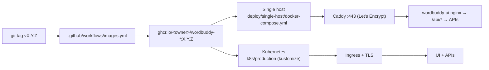

# Plan: Production deployment: single host (Docker Compose) and Kubernetes

## Summary

CI builds versioned images to GHCR. Two production paths use those images: a single-host Compose stack behind Caddy (automatic HTTPS), and a Kustomize production overlay for any cluster. Each API gets a `migrate` run mode (migrations, plus a one-time admin bootstrap in Identity). This mode runs before the API starts. A nightly `pg_dump` job provides backups.



Decision record: new ADR `docs/adr/0010-production-deployment-topology.md`.

## Affected services / areas

| Area | Change |
| --- | --- |
| Identity, Content, Quiz, Progress (Api + Infrastructure) | `migrate` run mode; Identity admin bootstrap; forwarded headers |
| Notification (Api) | Production config only (no DB, no migrate) |
| `WordBuddy.Shared.Infrastructure` | New `AddWordBuddyForwardedHeaders` helper → package `1.4.0` |
| `WordBuddy.UI/nginx.conf` | Pass `X-Forwarded-For` / `X-Forwarded-Proto` |
| `WordBuddy/deploy/single-host/` (new) | Production Compose, Caddyfile, `.env.example`, Postgres init, backup/restore scripts |
| `WordBuddy/k8s/` | New `kustomization.yaml` files (base) + `k8s/production/` overlay; kind files unchanged |
| `.github/workflows/images.yml` (new) | Build + push 6 images to GHCR |
| `WordBuddy/Makefile` | New `k8s-prod-*` targets only; existing targets unchanged |
| Docs | ADR 0010, runbooks `docs/deployment/single-host.md` + `kubernetes.md`, README links |
| Frontend code (`WordBuddy.UI/src`) | None |

## Backend approach

### 1. `migrate` run mode (Identity, Content, Quiz, Progress)

Same image, different command: `dotnet WordBuddy.<Service>.Api.dll migrate`.

```text
Program.Main(args)
  ├─ build host as today
  ├─ args[0] == "migrate" → DatabaseMigrator.RunAsync(app.Services) → exit code 0 / 1
  └─ else → UseWordBuddyMiddlewareAsync + app.Run()   (unchanged)
```

- New `Api/Extensions/MigrationRunner.cs` (one per service, no shared code): runs `dbContext.Database.MigrateAsync()`, logs start/end, returns exit code. On failure, it logs at `Error` (no connection string) and returns 1.
- This mode does not start the web server, MassTransit or the outbox. `migrate` returns before `app.Run()`.
- Identity: `migrate` also runs `AdminBootstrapper` (see 2).
- Development behaviour unchanged: the `IsDevelopment()` branch still migrates + seeds on startup.
- Production never seeds demo users, sample lessons or sample quizzes.
- This mode also makes the existing broken `dotnet ef` inside runtime images unnecessary for production. The runtime images have no SDK.

### 2. Admin bootstrap (Identity)

New `Infrastructure/Seeding/AdminBootstrapper.cs` and `AdminBootstrapOptions` (section `Bootstrap:Admin`).

| Key | Source | Rule |
| --- | --- | --- |
| `Bootstrap__Admin__Email` | secret | valid email |
| `Bootstrap__Admin__Password` | secret | min 12 chars |
| `Bootstrap__Admin__DisplayName` | config | default `Admin` |

| State | Result |
| --- | --- |
| An admin user already exists | Skip, log `Information`, exit 0 |
| No admin, options valid | Create `User` (`AgeGroup.Adult`, `IsAdmin = true`, BCrypt work factor 12), exit 0 |
| No admin, options missing/invalid | Log `Error` "admin bootstrap not configured", exit 1 (first deploy stops visibly) |

- Never log the email or the password. Log only "admin created" / "admin exists".
- Runbook: change the password after first login, then remove the password from the secret.
- The admin is always `Adult`. A `Child` admin is impossible by construction.

### 3. Forwarded headers (behind the proxy)

Rate limiting partitions anonymous calls (login, register) by `RemoteIpAddress`. Behind Caddy → nginx, every caller would share one partition.

- `WordBuddy.Shared.Infrastructure` 1.4.0: `AddWordBuddyForwardedHeaders(IConfiguration)` + `UseWordBuddyForwardedHeaders()`. It handles `XForwardedFor | XForwardedProto`. Trusted proxies come from `ForwardedHeaders:KnownNetworks` (CIDR list). The default is empty, so the helper does nothing.
- Identity, Content, Quiz and Progress call it first in the pipeline and bump the package to 1.4.0. Notification has no public endpoints and stays on its current version.
- Production config sets `KnownNetworks` to the Compose network / cluster pod CIDR (documented in runbooks).

### 4. Production configuration (no code)

| Setting | Value |
| --- | --- |
| `ASPNETCORE_ENVIRONMENT` | `Production` (Swagger off — it is already Development-only) |
| `Database__Provider` | `Postgres` (default); `SqlServer` possible |
| Connection strings | One role per service (`wb_identity`, `wb_content`, `wb_quiz`, `wb_progress`), each owner of its own database only |
| `Jwt__Secret`, RabbitMQ creds, `Autofill__Claude__ApiKey` (optional) | Secret store only |
| `Autofill__UseFakeClients` | Ignored outside Development (existing guard) |

### 5. Single host — `WordBuddy/deploy/single-host/`

```text
caddy (:80, :443 — only published ports)
  └→ wordbuddy-ui (nginx :80) ─ /api/* → identity / content / quiz / progress
postgres ← postgres-init (DBs + roles) ← *-migrate (one-shot) ← *-api
rabbitmq (no published ports, no management plugin)
backup (crond: nightly pg_dump + media tar)
```

- `docker-compose.yml` uses only `image: ${IMAGE_REGISTRY}/wordbuddy-<svc>:${WORDBUDDY_VERSION}`. It has no `build:`, so the host never builds. This avoids the GitHub Packages restore and the Compose bake `fs.read` issue on the host.
- `identity-migrate`, `content-migrate`, `quiz-migrate` and `progress-migrate` use the API image with `command: ["migrate"]`. Each API has `depends_on: <svc>-migrate: service_completed_successfully`, so `docker compose up -d` migrates on every release.
- `postgres-init` (`postgres/init.sh`): creates 4 databases and 4 login roles from env passwords. It is idempotent.
- Pinned image tags (no `latest`), `restart: unless-stopped`, `mem_limit` per container. Budget for a 2 GB host:

| Container | Limit |
| --- | --- |
| postgres (`shared_buffers=128MB`) | 384 MB |
| rabbitmq (`rabbitmq:4-alpine`, `vm_memory_high_watermark.absolute=200MB`) | 256 MB |
| 5 APIs | 192 MB each (workstation GC: `DOTNET_gcServer=0`) |
| ui, caddy, backup | 64 MB each |
| Total | ~1.8 GB ceiling, ~1.05 GB measured idle |

- `Caddyfile`: `{$SITE_ADDRESS}` → `reverse_proxy wordbuddy-ui:80`, HSTS header, `request_body max_size 50MB`. `SITE_ADDRESS=localhost` gives `tls internal` for local smoke tests.
- Health: `make`-free script `scripts/health.sh` runs a `curlimages/curl` one-shot on the Compose network. It checks `/health/ready` on all 5 APIs.
- `docker-compose.sqlserver.yml` (optional overlay): swaps postgres for SQL Server. The runbook states that SQL Server needs ≥ 2 GB for itself, so it does not fit the 2 GB host.

### 6. Kubernetes — `k8s/production/` (Kustomize)

The kind path (`make k8s-apply`, `kubectl apply -f` per file) stays as is. New files only:

| File | Content |
| --- | --- |
| `k8s/kustomization.yaml` | Common resources: namespace, rabbitmq, 5 API Deployments/Services, UI, Ingress. No configmap/secret/DB. |
| `k8s/postgres/kustomization.yaml` | Postgres StatefulSet + Service only |
| `k8s/production/kustomization.yaml` | `resources: [.., ../postgres, ...]`, `images:` (GHCR name + tag), `configMapGenerator` (Production config), `secretGenerator` from `secret.env` (gitignored; `secret.env.example` committed) |
| `production/patches/*.yaml` | `imagePullPolicy: Always`, `imagePullSecrets` (if images are private), migrate `initContainer` per data API, resource limits |
| `production/postgres-init-job.yaml` | DBs + per-service roles (same script as single host) |
| `production/media-pvc.yaml` | Replaces Content `emptyDir` with a PVC |
| `production/rabbitmq-pvc.yaml` | Replaces RabbitMQ `emptyDir` |
| `production/ingress-patch.yaml` | `host`, `tls.secretName: wordbuddy-tls`, class from config |
| `production/backup-cronjob.yaml` + `backup-pvc.yaml` | Nightly `pg_dump` of 4 DBs, retention 14 days |
| `production/networkpolicy.yaml` | Default deny ingress; allow ingress controller → UI/APIs, APIs → postgres/rabbitmq, progress → content:8081 |

- Migration: each data API Deployment gets `initContainers: [migrate]` (same image, `args: ["migrate"]`), so `kubectl apply -k` is the single path. EF Core migration locking guards concurrent runs. Identity's init container also gets the bootstrap secret keys.
- TLS: a pre-created `wordbuddy-tls` Secret, or cert-manager (optional annotation documented). Both are free and work with any provider.
- Make targets: `k8s-prod-render` (`kubectl kustomize`), `k8s-prod-apply VERSION=x.y.z` (`kustomize edit set image` in a temp copy + `kubectl apply -k`), `k8s-prod-health`. They use whatever kube context is active, with a confirm prompt that shows the context name.

### 7. CI — `.github/workflows/images.yml`

- Trigger: push of tag `v*` + `workflow_dispatch`.
- Matrix: identity, content, quiz, progress, notification, ui.
- `docker/build-push-action` with `secrets: github_token=${{ secrets.GITHUB_TOKEN }}`, `permissions: packages: write, contents: read`.
- Tags: `X.Y.Z`, `X.Y`, `sha-<short>`. OCI labels (source, revision). Platform `linux/amd64`.
- Prerequisite (runbook): shared packages are published (`make publish-shared`), and each package grants this repo's Actions read access. The first run also closes the known gap "GitHub Packages restore inside `docker build` not verified".

### 8. Backups and restore

| Path | Backup | Restore |
| --- | --- | --- |
| Single host | `backup` container, 02:00 daily: `pg_dump -Fc` per DB + `media` tar → `./backups/<date>/`, files `0600`, keep 14 days | `scripts/restore.sh <date>`: stop APIs → `pg_restore --clean` per DB → untar media → start |
| Kubernetes | CronJob → backup PVC (DBs only) | `kubectl` Job from runbook |
| SQL Server (either) | Documented `BACKUP DATABASE` commands, not automated | Documented |

Off-host copy is the operator's job. The runbook describes an encrypted copy (backups hold child PII).

### Child vs. adult

No change in learner behaviour for either age group. Child data protection applies to operations:

- HTTPS only (HTTP → HTTPS redirect, HSTS).
- DB and RabbitMQ are never published or exposed through Ingress. Swagger is off in Production.
- Backups have restricted file permissions, and the runbook requires encryption for off-host copies.
- Secrets live only in `.env` / Kubernetes Secrets created from examples, and are never logged.

## Frontend approach

No `src/` change. `WordBuddy.UI/nginx.conf`: add `X-Forwarded-For $proxy_add_x_forwarded_for` and `X-Forwarded-Proto $http_x_forwarded_proto` (fallback `$scheme`) to every `/api/*` location. The local dev and kind behaviour stays the same.

## Data / migration notes

- No new EF Core migrations and no schema change.
- Production databases are created by the init step and migrated by `migrate` mode.
- Admin user: inserted by `AdminBootstrapper` on first run only.

## Open questions

1. **Image visibility** — GHCR images public (no pull secret) or private (host `docker login`, k8s `imagePullSecrets`)? Default in plan: private, pull secret documented.
2. **Ingress controller** — upstream ingress-nginx is retired (maintenance ended March 2026). Default in plan: keep a standard `networking.k8s.io/v1` Ingress, class set in the overlay, and document Traefik as the tested controller. Gateway API would be a separate proposal.
3. **Shared package bump** — forwarded headers as a shared helper (Shared.Infrastructure 1.4.0, 4 services bump). The alternative is five small copies. Default: shared helper.
4. **Per-service DB roles** — plan uses one least-privilege role per service instead of `postgres` superuser. This adds 4 secrets. OK?
5. **Starter content in Production** — the plan seeds no lessons or quizzes. Admins create content. Confirm.
6. **CPU architecture** — `linux/amd64` only, or also `linux/arm64` (slower CI)?
7. **Backup encryption** — the plan documents an encrypted off-host copy but does not automate it. Automate with `age`/`gpg` now?
8. **Kubernetes test target** — `/test` can validate the overlay on kind (render + apply + health) only. Is a real cluster run required for "done"?

## Scope suggestions (not in this plan)

- PR CI workflow (build + unit + integration tests on both providers) — the plan covers image publishing only.
- Fix local `make migrate` / `make k8s-migrate` to use the new `migrate` mode. Today they call `dotnet ef` in a runtime image without the SDK.
- Automated off-host backup upload (S3-compatible, rclone).
- Gateway API instead of Ingress.
