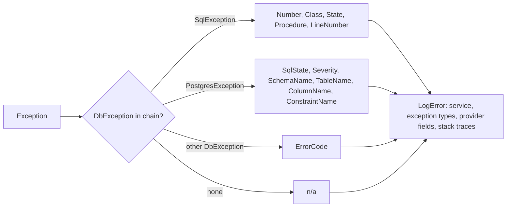
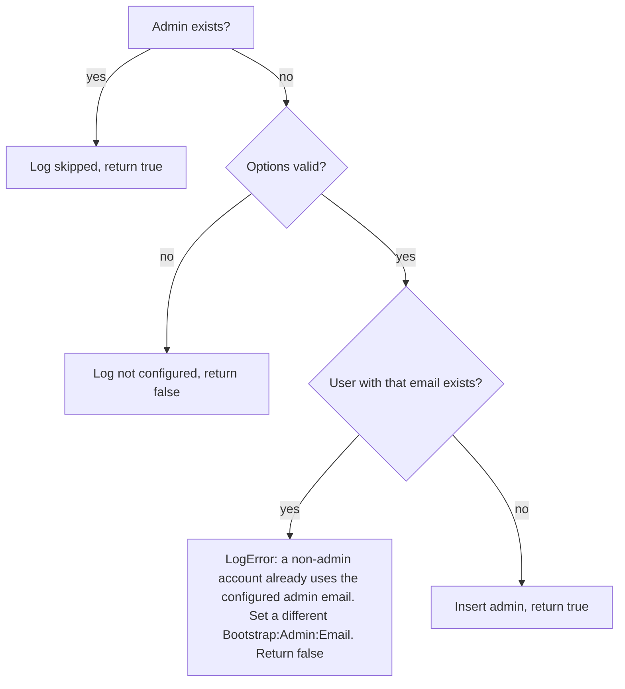

# Plan: WB-77 Fix WB-75 review nits A and B

## Summary

Two small fixes on the WB-75 deployment feature:

- **A:** `MigrationFailureLog` stops logging the provider message. It logs only data-free fields: error code, severity, schema names, stack trace. The Identity admin bootstrap checks for an email clash before the insert and fails with a clear, PII-free error.
- **B:** `sqlserver/init.sh` validates all five passwords before any SQL runs. The SQL Server overlay uses `${VAR:?}` so Compose fails fast.

## Affected services / areas

| Area | Files | Change |
| --- | --- | --- |
| Identity, Content, Quiz, Progress (Api) | `WordBuddy.<S>.Api/Extensions/MigrationFailureLog.cs` | Withhold provider message; log structured, data-free fields |
| Identity (Infrastructure) | `Seeding/AdminBootstrapper.cs` | Email-clash check before insert |
| 4 services (IntegrationTests) | `MigrationFailureLogTests.cs`, Identity `MigrationAndBootstrapTests.cs` | New tests |
| Single-host deploy | `deploy/single-host/sqlserver/init.sh`, `docker-compose.sqlserver.yml`, `.env.example` | Password checks, fail fast |
| Docs | `docs/deployment/single-host.md` | Password rules for SQL Server |

No frontend change. No cross-service call or contract change.

## Backend approach

### A1. Why the current log leaks data

| Provider | Exception | What `Message` holds for a unique-key violation | Leaks key value? |
| --- | --- | --- | --- |
| SQL Server | `SqlException` 2601 / 2627 | `... The duplicate key value is (admin@example.com).` | **Yes** |
| PostgreSQL | `PostgresException` 23505 | `23505: duplicate key value violates unique constraint "IX_Users_Email"` + `DETAIL: Detail redacted ...` | No, by default |

Postgres check (Npgsql 10):

- `PostgresException.Message` = `SqlState: MessageText`, plus `DETAIL:` line.
- The key value is only in `Detail` (`Key ("Email")=(...) already exists.`).
- Npgsql redacts `Detail` unless the connection string sets `Include Error Detail=true`. No WordBuddy config sets it today.
- **But** `MessageText` itself can carry values for other errors, for example class 22 (`invalid input syntax for type uuid: "..."`). So Postgres is safe for 23505, not safe in general.

Conclusion: an allowlist of data-free fields is safer than a denylist of error codes on either provider.

### A2. New `MigrationFailureLog` shape

Same structure in all 4 copies; only the namespace differs (ADR 0001).

- Never log `Message`, `MessageText`, `Detail`, `Hint`, `Where` or `InternalQuery`. These are server text and may hold row values.
- Schema names (table, column, constraint) are model metadata, not user data. They keep the log useful.
- Keep the message template stable: `"{Service} migration failed: {ExceptionType}, provider error code {ProviderErrorCode}, provider details {ProviderDetails}{NewLine}{StackTrace}"`.
- Update the XML `<remarks>` to say why the message is withheld.
- Diagnosis uses the documented error code (for example 18456 = login failed, 4060 = cannot open database, 28P01 = bad password).

### A3. Admin bootstrap email clash

- Check with `dbContext.Users.AnyAsync(u => u.Email == options.Email)`. It uses the same comparison as the unique index on each provider (SQL Server collation case-insensitive, Postgres case-sensitive).
- **Never promote the existing user.** Someone could register the admin email before the first deploy; promotion would give that person admin rights. Fail closed.
- The error message names the setting, not the email.
- A race (register between check and insert) still hits the unique index. A2 makes that log PII-free.
- Child vs. adult: same behaviour. An existing Child or Adult account with that email is never changed.

### B. SQL Server init passwords

`init.sh` gets a `require_password NAME` function, called for all five variables **before** the first `sqlcmd`:

| Check | Result |
| --- | --- |
| Variable unset or empty | `init: NAME is empty` on stderr, exit 1 |
| Not `^[A-Za-z0-9]{16,}$` (bash `[[ =~ ]]`) | `init: NAME must be 16+ letters and digits` on stderr, exit 1 |
| All pass | Run the existing `setup` calls |

- Read with indirect expansion `${!name:-}` so `set -u` does not abort with a vague message.
- Never echo the value.
- Variables: `MSSQL_SA_PASSWORD`, `IDENTITY_DB_PASSWORD`, `CONTENT_DB_PASSWORD`, `QUIZ_DB_PASSWORD`, `PROGRESS_DB_PASSWORD`.

`docker-compose.sqlserver.yml`: every `${SA_PASSWORD}` and `${<S>_DB_PASSWORD}` becomes `${VAR:?VAR must be set in .env}` (sqlserver, sqlserver-init, 4 migrate jobs, 4 APIs).

SA complexity: SQL Server needs 3 of 4 character classes for `sa`. `openssl rand -hex 24` has only lower case and digits, so it fails for `sa`. Docs and `.env.example` give a mixed-case generator for `SA_PASSWORD`, for example `openssl rand -base64 48 | tr -dc 'A-Za-z0-9' | head -c 32`. The four service logins keep `CHECK_POLICY = OFF`, so hex stays fine for them.

## Frontend approach

None.

## Data / migration notes

None. No schema change, no EF Core migration.

## Child vs. adult

No role-specific behaviour. Both profit from the same rule: no emails or key values in logs. The bootstrap never alters an existing account of either age group.

## Open questions

1. **Allowlist vs. denylist for A.** Plan: never log the provider message (allowlist of fields). Alternative: keep the message except for known data-bearing codes (2601, 2627, 245, 2628, 8152; Postgres class 22/23). Allowlist loses some free text (for example the user name in "Login failed for user ..."), but it cannot miss a code. Recommended: allowlist.
2. **Bootstrap clash exit code.** Plan: exit 1, so the deploy stops and the operator fixes `BOOTSTRAP_ADMIN_EMAIL`. Alternative: log a warning and exit 0. Recommended: exit 1 (fail closed).
3. **Living spec.** Line 23 and 24 of the WB-75 feature doc still hold. The tester adds "provider message withheld" and "email clash fails" when it updates the spec.

Ideas beyond the issue goal (not in this plan):

- Same empty-value and character checks in `postgres/init.sh` and `k8s/production/postgres-init.sh`.
- `${VAR:?}` for all secrets in the base `docker-compose.yml`.
- `UserRepository` logs `Email` at Debug and Warning level (PII in logs outside the migrate path).
