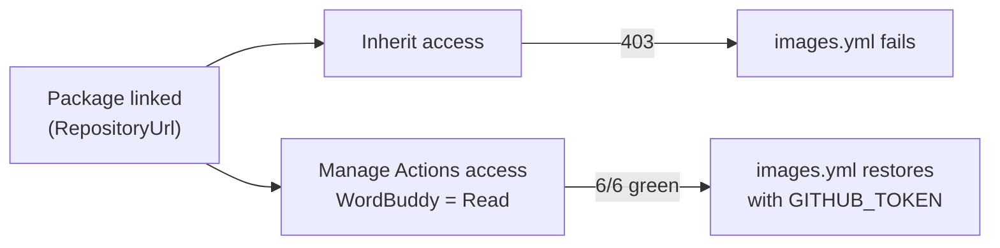

# Plan: WB-81 docs: Manage Actions access Read per shared package

## Summary

Docs-only fix. Three places say "linked repo + Inherit access" is enough for CI to restore the shared packages. It is not. Each place gets the per-package step: package settings → "Manage Actions access" → add `WordBuddy`, role Read.



## Affected services / areas

| Area | File | Change |
| --- | --- | --- |
| CI | `.github/workflows/images.yml` lines 3-5 | Header comment only |
| Backend docs | `WordBuddy/README.md` lines 193-196 | Shared-package note |
| Living spec | `docs/features/WB-75_...md` line 21 | "Images" bullet (tester, at `/test`) |
| `WordBuddy/CLAUDE.md` lines 170-171 | — | Ask-gated; text proposed below, Sam applies |

Not changed:

- `docs/releases/v1.0.1.md` — immutable. Its known issue is resolved by this change; the next release note can say so.
- `docs/deployment/*.md`, `docs/sdlc/*.md` — checked. They do not describe the package access step. Their `PAT with read:packages` lines are about GHCR image pulls, which is correct.
- ADR 0001 / 0010 — no access detail. Append-only. No change.
- No workflow step, package version, `.csproj` or application code.

## Backend approach

No code. Text changes only.

### 1. `images.yml` header (lines 3-5)

Replace:

```
# Prerequisites: the WordBuddy.Shared.* packages are published to GitHub Packages
# (make publish-shared) and each package is linked to this repository (RepositoryUrl in
# src/Shared/Directory.Build.props) and inherits its access, so GITHUB_TOKEN can restore it.
```

with:

```
# Prerequisites: the WordBuddy.Shared.* packages are published to GitHub Packages
# (make publish-shared) and linked to this repository (RepositoryUrl in
# src/Shared/Directory.Build.props). Each package also needs, once, in its settings:
# "Manage Actions access" -> add repository WordBuddy, role Read. Without it, restore with
# GITHUB_TOKEN fails with NU1301 (403), even with "Inherit access" on.
```

### 2. `WordBuddy/README.md` (lines 193-196)

Keep the current text. Add after it:

> CI (`images.yml`) restores the shared packages with `GITHUB_TOKEN`. For that, each package
> needs one manual step on GitHub: package settings → "Manage Actions access" → "Add
> repository" → `WordBuddy`, role Read. The repo link and "Inherit access" alone return 403.
> Do this for every new `WordBuddy.Shared.*` package.

Note: the access setting is per package, not per version. New versions of an existing package keep it. Only a new package id needs the step.

### 3. Living spec line 21 (deferred to `/test`)

The tester replaces the linked-repo sentence with:

> The 5 `WordBuddy.Shared.*` packages are linked to the repo (`RepositoryUrl` in `src/Shared/Directory.Build.props`), and each grants `WordBuddy` Read under "Manage Actions access". The GitHub Packages restore uses `GITHUB_TOKEN` as a BuildKit secret, with no stored PAT.

Then moves the WB-81 line from "Pending changes" to "Change history". The pending line already exists (line 73, uncommitted in the working tree).

### 4. Proposed `WordBuddy/CLAUDE.md` text (ask-gated, Sam applies)

Supersedes WB-79 plan §6. Replace lines 170-171:

> Known gap: the GitHub Packages restore inside `docker build` has not been verified end-to-end
> with a real PAT (`read:packages`; `write:packages` for `make publish-shared`).

with:

> Shared packages carry `RepositoryUrl` (`src/Shared/Directory.Build.props`), so GitHub links
> them to `hunglu/WordBuddy`. CI (`images.yml`) restores them with `GITHUB_TOKEN`; each package
> also needs "Manage Actions access" → `WordBuddy` (Read) in its GitHub settings (once per new
> package; the link alone gives 403). Local `make up` / kind builds use a PAT (`read:packages`;
> `write:packages` for `make publish-shared`).

The WB-79 precondition ("apply after `images.yml` is green") is met: runs 45862707216 and 46025041915 were green.

## Frontend approach

None.

## Data / migration notes

None.

## Child vs. adult

No difference. Build and release docs only; no runtime change for either `AgeGroup`.

## Open questions

1. **Package settings URL.** The plan names the menu path, not the URL (`github.com/users/hunglu/packages/nuget/<name>/settings`), to keep docs owner-neutral. Sam may prefer the full URL in `README.md`.
2. **Out of scope idea:** a CI pre-check that fails early with a clear message when a shared package lacks Actions access. Not planned here (see report).
