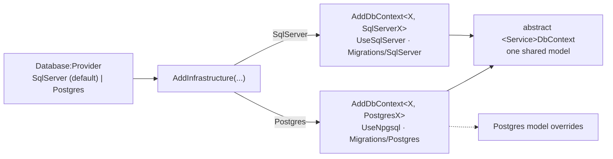

# 0009 — PostgreSQL as a second persistence provider

- Status: accepted
- Date: 2026-11-18 (WB-71)

## Context

- Identity, Content, Quiz and Progress persisted only to SQL Server through EF Core.
- SQL Server needs about 2 GB RAM on its own. The default container image is Developer edition, which is not licensed for production.
- WordBuddy therefore could not run on low-resource hosts (2 GB RAM or less).
- SQL Server must stay available: dev, compose, k8s, Aspire and the integration tests use it today.
- ADR 0001 forbids project references between services and to shared code.

## Decision

Add **PostgreSQL** as a second EF Core provider, selected per service by configuration. **SQL Server stays the default.** This adds an adapter; it does not replace SQL Server.

| Topic | Decision |
| --- | --- |
| Switch | `Database:Provider` = `SqlServer` (default) or `Postgres`. Read once at startup. Unknown value stops the host. Same pattern as `Services:Content:Transport` (ADR 0008) |
| Scope | Identity, Content, Quiz, Progress. Notification has no database |
| Layering | Only Infrastructure changes (plus one optional parameter in `WordBuddy.Shared.Infrastructure`, see Outbox). Domain and Application do not know the provider |
| Model | One `abstract <Service>DbContext` holds the model. A thin subclass per provider (`SqlServer<Service>DbContext`, `Postgres<Service>DbContext`) owns that provider's migrations. The SQL Server subclass adds nothing, so its model stays identical (`HasPendingModelChanges() == false`). The Postgres subclass applies `Postgres<Service>ModelOverrides` |
| Migrations | Two sets per service, in `Migrations/SqlServer/` and `Migrations/Postgres/`, inside the existing Infrastructure project. PostgreSQL starts from one `InitialCreate` that matches the current SQL Server schema |
| Migration move | The existing SQL Server migrations move to `Migrations/SqlServer/` once (WB-71). Only namespace, `[DbContext]` type and snapshot class name change. Migration ids do not change, so `__EFMigrationsHistory` rows still match. A unit test pins the id list. This is a one-time exception to the "never edit an applied migration" rule |
| Filtered indexes | Re-declared in the Postgres overrides with `"Column"` quoting and `TRUE` instead of `1` |
| NULL semantics | SQL Server treats NULLs as equal in a unique index; PostgreSQL does not. The unique index `(NormalizedLemma, PartOfSpeech)` uses `NULLS NOT DISTINCT` on Postgres (PostgreSQL 15 or newer) |
| Concurrency token | SQL Server `rowversion` shadow property; Postgres maps the `xmin` system column instead |
| Row locking | Per-service `IDatabaseDialect` (Content, Progress). Progress challenge join: SQL Server key-range lock hints; Postgres `SELECT ... FOR UPDATE` on the parent `Challenges` row, then count |
| Error codes | `IDatabaseDialect` classifies unique, foreign-key and deadlock errors (SQL Server 2601/2627/547/1205; Postgres SQLSTATE `23505`/`23503`/`40P01`). Repositories catch `DbException`, not `SqlException` |
| Aborted transactions | PostgreSQL aborts a whole transaction on any error. A raw statement whose error is caught inside an open transaction runs behind a savepoint (`LexemeAdminRepository` guarded delete). `SaveChanges` already uses an EF-created savepoint inside a user transaction |
| Raw SQL | Orphan lexeme deletes became `ExecuteDeleteAsync` (one LINQ statement, both providers). Only the guarded media delete (`OUTPUT` vs `RETURNING`) stays provider-specific, in the dialect |
| Random order | `OrderBy(Guid.NewGuid())` stays: EF translates it to `NEWID()` / `gen_random_uuid()`. `EF.Functions.Random()` is **not** used: on SQL Server it becomes `RAND()`, one value per query, so nothing is shuffled |
| Case sensitivity | SQL Server compares case-insensitively by default; PostgreSQL does not. Postgres uses **`citext`** columns (`Users.Email`, `Users.Alias`, `Users.DisplayName`, `Senses.Word`) so equality and `Contains` match SQL Server. No SQL Server schema change, no Domain change. The admin lexeme search upper-cases its term (lemmas are stored upper-case) |
| DateTime | Postgres maps every `DateTime` to `timestamp with time zone`. Write treats the value as UTC; read returns `Kind.Unspecified`, like SQL Server `datetime2`. JSON output does not change. `EnableLegacyTimestampBehavior` is rejected (global switch) |
| Naming | EF default PascalCase, quoted, on Postgres (no snake_case). Index and FK names stay identical |
| Messaging | The MassTransit EF outbox and inbox run on both providers. `AddWordBuddyMessaging<T>(..., OutboxLockProvider lockProvider = SqlServer)` selects `UseSqlServer()` or `UsePostgres()`. Backward compatible; `WordBuddy.Shared.Infrastructure` 1.3.0 |
| Image | `postgres:17-alpine` everywhere. Minimum supported version: 15 |
| Independence | No shared persistence package. Each service carries its own provider code (ADR 0001) |
| Rejected | **Replace SQL Server with PostgreSQL** (breaks current setups, removes a choice). **MongoDB** (relational model, transactions, filtered unique indexes and the EF outbox do not fit). **Normalized columns for case-insensitive lookups** (needs Domain and schema changes; `citext` is enough). **snake_case naming** (renames every object, breaks index names used in code) |

## Consequences

- The full stack can run on a 2 GB RAM host with PostgreSQL.
- Every schema change ships **two migrations** with the same name, one per provider. The `ef-migration` skill creates both. A migration without its Postgres twin is a review **major**.
- Integration tests run against both providers: `WORDBUDDY_TEST_DB_PROVIDER` (`SqlServer` default or `Postgres`) and `WORDBUDDY_TEST_PG_CONNECTION_STRING` (server part only). No CI workflow exists yet, so the tester runs the suites twice.
- docker compose (`docker-compose.postgres.yml`, `make up-postgres`), k8s (`k8s/postgres/`, `make k8s-apply DB=postgres`) and Aspire (`db-provider=Postgres`) gain an optional PostgreSQL setup. SQL Server remains the default.
- Mixing providers across services works (each service reads its own key) but is not tested. All orchestration options set one provider for all four services.
- Out of scope: moving existing data from SQL Server to PostgreSQL, CI pipeline, Testcontainers, `jsonb` for JSON list columns, per-container memory limits.
