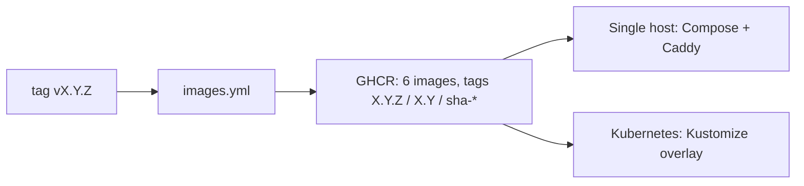

# 0010 — Production deployment topology

- Status: proposed
- Date: 2026-11-22 (WB-75)

## Context

- WordBuddy ran only on developer machines (Compose with local builds, kind, Aspire).
- Production needs two paths: one small host (2 GB RAM) and any Kubernetes cluster.
- Building images on the host needs GitHub Packages access and a build toolchain. Both are unwanted there.
- The runtime images have no SDK, so `dotnet ef` cannot migrate a production database.
- The learner data includes children's data: HTTPS only, no exposed database, restricted backups.

## Decision

| Topic | Decision |
| --- | --- |
| Images | One set of 6 images (`linux/amd64`), built in CI, private GHCR, pinned tags, never `latest`. Both paths pull the same images. No build on the host |
| Single host | `WordBuddy/deploy/single-host/`: Compose with Caddy (automatic HTTPS, only published ports 80/443), UI nginx, 5 APIs, PostgreSQL, RabbitMQ, backup container. Fixed `mem_limit` per container for a 2 GB host |
| Kubernetes | `k8s/production/` Kustomize overlay on a base (`k8s/base`, `k8s/postgres`). Standard `networking.k8s.io/v1` Ingress with a configurable class (Traefik documented, the retired ingress-nginx is not required). TLS Secret or cert-manager. NetworkPolicy default deny. PVCs for media and RabbitMQ |
| Migration | New run mode `dotnet WordBuddy.<Service>.Api.dll migrate`: applies migrations, then exits (no web server). Compose runs it as one-shot `*-migrate` services; Kubernetes as an `initContainer`. Development keeps migrate-on-start |
| First admin | Identity `migrate` creates one Adult admin from `Bootstrap:Admin` if no admin exists. Production seeds no demo users or content |
| Database | PostgreSQL by default (ADR 0009), one least-privilege owner role per service. SQL Server stays possible through an overlay, not automated |
| Proxy headers | `WordBuddy.Shared.Infrastructure` 1.4.0 `AddWordBuddyForwardedHeaders`: trusts `X-Forwarded-For/Proto` only from `ForwardedHeaders:KnownNetworks`. Needed so rate limiting sees real client IPs |
| Backups | Single host: nightly `pg_dump -Fc` per database + media tar, 14 days, files `0600`. Kubernetes: CronJob to a PVC (databases only). Off-host copy and its encryption are the operator's job (documented) |

## Consequences

- One image path for both targets; a release is a tag.
- `kubectl kustomize` for the overlay needs `--load-restrictor=LoadRestrictionsNone` (the base reads the existing manifests one level up). The `make k8s-prod-*` targets set it.
- The Postgres init script exists twice (single host and `k8s/production`); `make k8s-prod-render` fails when they differ.
- NetworkPolicy is not enforced by kind's default CNI; it is verified on a real cluster only.
- Verified on kind and a local Compose stack. A real cluster run is not part of the acceptance.
- Gateway API, S3 backup upload and `arm64` images are out of scope.
