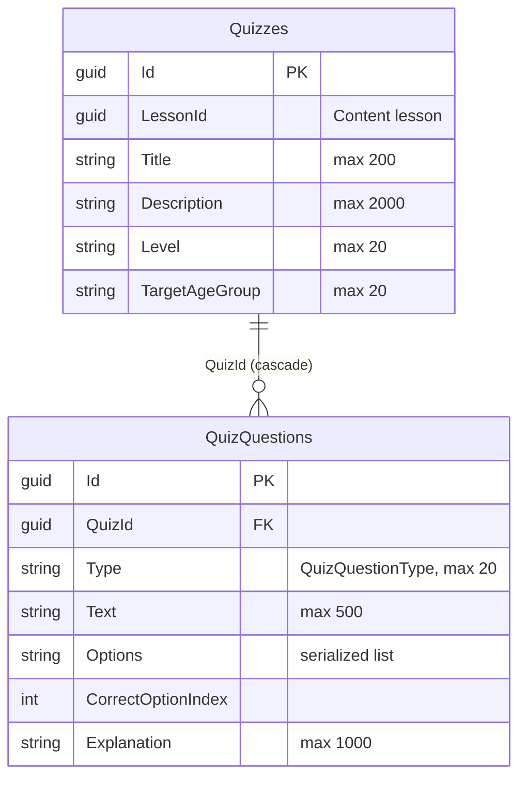

# Quiz — database diagram

Database `WordBuddyQuiz` · source: `SqlServerQuizDbContextModelSnapshot.cs`

> **PostgreSQL:** On PostgreSQL (`Database:Provider=Postgres`, ADR 0009) `QuizQuestions.Options` is `text` instead of `nvarchar(max)`. Logical schema, names and indexes are the same. Postgres migrations: `Migrations/Postgres/` (last: `InitialCreate`).

| Index | Columns | Unique |
| --- | --- | --- |
| `IX_QuizQuestions_QuizId` | `QuizId` | — |

- `Quizzes.LessonId` is a Content lesson id — no FK.
