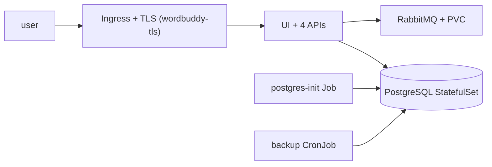

# Runbook: Kubernetes

Result: WordBuddy runs in a namespace `wordbuddy` of any cluster, behind an Ingress with TLS. Files: `WordBuddy/k8s/production/`. Decision: ADR 0010.



The kind path (`make k8s-apply`) is for local development and is unchanged.

## 1. Cluster prerequisites

| Item | Needs |
| --- | --- |
| Kubernetes | 1.28 or newer, `kubectl` and `kubectl kustomize` on your machine |
| Ingress controller | Any controller that supports `networking.k8s.io/v1` Ingress. Traefik is the documented one (upstream ingress-nginx is retired) |
| Storage class | A default class for PVCs (PostgreSQL 5 Gi, media 10 Gi, RabbitMQ 2 Gi, backups 5 Gi). Set `storageClassName` in the PVC files if needed |
| TLS | A pre-created Secret, or cert-manager (optional, section 4) |
| CNI | One that enforces NetworkPolicy (Calico, Cilium, ...). kindnet does not |
| Images | In GHCR: `ghcr.io/<owner>/wordbuddy-*:<version>` |

## 2. Configure

```bash
cd WordBuddy/WordBuddy/k8s/production        # from the repository root
cp secret.env.example secret.env     # gitignored, fill every CHANGE_ME
```

Then edit these files:

| File | Change |
| --- | --- |
| `kustomization.yaml` | Replace `OWNER` in the six image names. Set `ForwardedHeaders__KnownNetworks__0` to your pod CIDR (`10.0.0.0/8` is the default) |
| `ingress-patch.yaml` | Host name, TLS host, `ingressClassName` (default `traefik`) |
| `networkpolicy.yaml` | Set the namespace of your ingress controller (see section 4) |
| `*-pvc.yaml` | `storageClassName`, sizes |

Database passwords appear twice in `secret.env` (role password and connection string): keep them equal and use letters and digits only.

Private images: create the pull secret once.

```bash
kubectl create namespace wordbuddy
kubectl -n wordbuddy create secret docker-registry ghcr-pull --docker-server=ghcr.io \
  --docker-username=<user> --docker-password=<PAT with read:packages>
```

## 3. Render and apply

```bash
cd ../..                                            # now in WordBuddy/WordBuddy
make k8s-prod-render | less                         # no cluster access
make k8s-prod-apply OWNER=<owner> VERSION=1.0.0      # shows the kube context, asks to continue
make k8s-prod-health                                 # waits for all Deployments
```

Order inside the cluster: PostgreSQL → `postgres-init` Job (databases and roles) → each data API's `migrate` init container → API. On the first deploy an init container may restart a few times until the Job has finished: that is normal.

`k8s-prod-apply` works on the **active kube context**. Check it first (`kubectl config current-context`).

## 4. Ingress controller and TLS

The NetworkPolicy lets only the ingress controller namespace reach the UI and APIs. Default: `ingress-nginx` and `traefik`. k3s runs Traefik in `kube-system`: add it to `values` in `networkpolicy.yaml`, but only if that is your controller (it opens the policy to all pods of that namespace). Check with `kubectl get pods -A | grep -i -e traefik -e ingress`.

Option A, pre-created Secret:

```bash
kubectl -n wordbuddy create secret tls wordbuddy-tls --cert=fullchain.pem --key=privkey.pem
```

Option B, cert-manager: install it, create a `ClusterIssuer` (for example Let's Encrypt), and add the annotation `cert-manager.io/cluster-issuer: <name>` to the Ingress in `ingress-patch.yaml`. cert-manager then creates `wordbuddy-tls`.

Upload limit: the base Ingress sets the ingress-nginx annotation `proxy-body-size: 50m`. Traefik ignores it; configure a buffering `Middleware` with `maxRequestBodyBytes: 52428800` and attach it with the `traefik.ingress.kubernetes.io/router.middlewares` annotation if you upload large media.

## 5. First admin

1. Open `https://<host>` and sign in with `Bootstrap__Admin__Email` and its password.
2. Change the password in the profile page.
3. Remove `Bootstrap__Admin__Password` (and `Bootstrap__Admin__Email`) from `secret.env` and run `make k8s-prod-apply` again. The init container reads these keys as `optional`, so the pod still starts. Once an admin exists, the bootstrap is skipped and exits 0.

If the pod stays in `Init:Error` for Identity on a fresh database (admin keys missing or invalid), read the log: `kubectl -n wordbuddy logs deploy/identity-api -c migrate`.

## 6. Upgrade

Run `make k8s-prod-apply OWNER=<owner> VERSION=<new>`. The init containers migrate before the new pods start.

## 7. Backup and restore

The CronJob `postgres-backup` runs at 02:00 UTC (the CronJob has no `timeZone`; add `spec.timeZone` in `backup-cronjob.yaml` to change it) and writes `pg_dump -Fc` files for the four databases into the `backup-data` PVC, folder `<YYYY-MM-DD>`, keeping 14 days. Media files are not in it: snapshot the `media-data` PVC with your storage provider.

Manual backup:

```bash
kubectl -n wordbuddy create job --from=cronjob/postgres-backup backup-manual
kubectl -n wordbuddy logs job/backup-manual
```

Copy backups off the cluster and **encrypt** the copy (children's data), for example with `gpg --symmetric`.

Restore (replaces current data): scale the APIs down, restore the four databases with a one-off Pod that mounts `backup-data`, scale up.

```bash
kubectl -n wordbuddy scale deploy identity-api content-api quiz-api progress-api --replicas=0
kubectl -n wordbuddy apply -f - <<'EOF'
apiVersion: v1
kind: Pod
metadata:
  name: pg-restore
  labels: { app: postgres-init }
spec:
  restartPolicy: Never
  containers:
    - name: restore
      image: postgres:17-alpine
      command: ["sh", "-c"]
      args:
        - |
          set -eu
          day="<YYYY-MM-DD>"
          for pair in WordBuddyIdentity:wb_identity WordBuddyContent:wb_content WordBuddyQuiz:wb_quiz WordBuddyProgress:wb_progress; do
            db="${pair%%:*}"; role="${pair##*:}"
            pg_restore --clean --if-exists --no-owner --role="$role" -d "$db" "/backups/$day/$db.dump"
          done
      env:
        - { name: PGHOST, value: postgres }
        - { name: PGUSER, value: postgres }
        - name: PGPASSWORD
          valueFrom: { secretKeyRef: { name: wordbuddy-secrets, key: POSTGRES_PASSWORD } }
      volumeMounts: [{ name: backups, mountPath: /backups, readOnly: true }]
  volumes:
    - name: backups
      persistentVolumeClaim: { claimName: backup-data }
EOF
kubectl -n wordbuddy logs pg-restore
kubectl -n wordbuddy delete pod pg-restore
kubectl -n wordbuddy scale deploy identity-api content-api quiz-api progress-api --replicas=1
```

## 8. Checks

| Check | Command |
| --- | --- |
| Pods ready | `make k8s-prod-health` |
| Ingress has TLS | `kubectl -n wordbuddy get ingress -o yaml` shows `tls:` |
| Database not exposed | `kubectl -n wordbuddy get svc` has no `LoadBalancer` or `NodePort` |
| NetworkPolicy | From a pod in another namespace, `postgres:5432` must time out |
| Swagger off | `curl -o /dev/null -w '%{http_code}' https://<host>/swagger/index.html` is `404` (or the UI page, never Swagger) |
