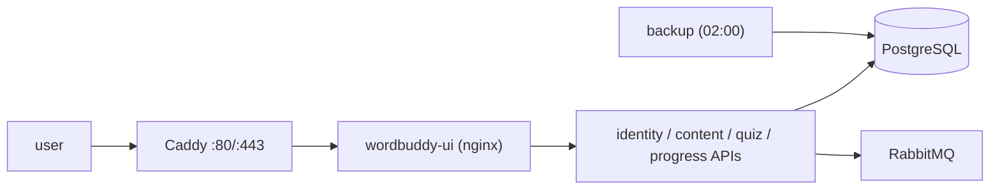

# Runbook: single host (Docker Compose)

Result: WordBuddy runs on one Linux host behind HTTPS. Files: `WordBuddy/deploy/single-host/`. Decision: ADR 0010.



## 1. Host prerequisites

| Item | Needs |
| --- | --- |
| OS | Linux (amd64) |
| Memory | 2 GB or more. Container limits add up to about 1.8 GB |
| Software | Docker Engine with Compose 2.24 or newer |
| DNS | A record of your host name points to the host |
| Ports | 80 and 443 open from the internet (needed for the certificate) |

## 2. Get the files and log in to GHCR

```bash
git clone <repo-url> && cd WordBuddy/WordBuddy/deploy/single-host
echo <PAT with read:packages> | docker login ghcr.io -u <github-user> --password-stdin
```

Images are private. Skip the login only if you made the packages public.

## 3. Configure

```bash
cp .env.example .env
chmod 600 .env
```

Edit `.env`. Replace every `CHANGE_ME` (generate with `openssl rand -hex 24`). Set at least:

| Variable | Value |
| --- | --- |
| `IMAGE_REGISTRY` | `ghcr.io/<owner>` (lower case) |
| `WORDBUDDY_VERSION` | release tag, for example `1.0.0` |
| `SITE_ADDRESS` | your host name |
| `BOOTSTRAP_ADMIN_EMAIL` / `_PASSWORD` | first admin (password 12 characters or more) |

Never commit `.env`. It is gitignored.

## 4. Start

```bash
docker compose up -d
```

Order: PostgreSQL → `postgres-init` (databases and roles) → `*-migrate` (one-shot) → APIs → UI → Caddy. The first start takes a minute for the certificate.

## 5. Check health

```bash
./scripts/health.sh
```

Prints one line per API (`OK` or `FAIL`). Exit code is non-zero on any failure. Then open `https://<SITE_ADDRESS>`.

## 6. First admin login

1. Sign in with `BOOTSTRAP_ADMIN_EMAIL` and the password.
2. Change the password in the profile page.
3. Remove `BOOTSTRAP_ADMIN_PASSWORD` from `.env` (it is not used again once an admin exists).

If the `identity-migrate` service exits with code 1, the admin variables are missing or invalid: `docker compose logs identity-migrate`.

## 7. Upgrade to a new release

```bash
# set WORDBUDDY_VERSION in .env, then
docker compose pull
docker compose up -d
./scripts/health.sh
```

Migrations run again before the APIs restart. Take a backup first (section 8).

## 8. Backup

The `backup` container runs every night at 02:00: one `pg_dump -Fc` file per database plus `media.tar.gz` in `./backups/<YYYY-MM-DD>/` (permissions `0600`). Backups older than 14 days are removed (`BACKUP_RETENTION_DAYS`).

Manual run:

```bash
docker compose exec backup sh -c '. /etc/backup.env && sh /backup/backup.sh'
ls -l backups/$(date +%F)     # 4 .dump files + media.tar.gz
```

**Copy backups off the host.** They contain children's data, so encrypt every off-host copy, for example:

```bash
tar -c backups/<date> | gpg --symmetric --cipher-algo AES256 -o wordbuddy-<date>.tar.gpg
```

Keep the passphrase outside the host. Encryption is not automated.

## 9. Restore

```bash
./scripts/restore.sh <YYYY-MM-DD>
./scripts/health.sh
```

It stops the APIs, restores the four databases and the media, then starts the stack. It asks you to type `restore` first. It replaces all current data.

## 10. Firewall check

From another machine:

```bash
nmap -Pn -p 22,80,443,5432,5672,15672,5080-5084 <host>
```

Only 80 and 443 (and your SSH port) may be open. Compose publishes nothing else.

## SQL Server (optional)

```bash
docker compose -f docker-compose.yml -f docker-compose.sqlserver.yml up -d
```

SQL Server needs 2 GB or more for itself: it does not fit a 2 GB host. The image default is the Developer edition, which is not licensed for production: set `MSSQL_PID` to a licensed edition. Set `SA_PASSWORD` in `.env`. The automatic backup is off. Back up with `BACKUP DATABASE` for the four `WordBuddy*` databases:

```bash
docker compose exec sqlserver /opt/mssql-tools18/bin/sqlcmd -S localhost -U sa -P "$SA_PASSWORD" -C \
  -Q "BACKUP DATABASE [WordBuddyIdentity] TO DISK = '/var/opt/mssql/backup/WordBuddyIdentity.bak'"
```

Repeat for Content, Quiz and Progress, and restore with `RESTORE DATABASE`.

## Local smoke test

Set `SITE_ADDRESS=localhost` in `.env`. Caddy uses its internal CA (self-signed): your browser warns once. Use `curl -k`.

## Troubleshooting

| Symptom | Check |
| --- | --- |
| No certificate | DNS record, ports 80/443 open, `docker compose logs caddy` |
| `identity-migrate` exits 1 | Bootstrap variables, `docker compose logs identity-migrate` (the log never shows the email or password) |
| An API is `FAIL` | `docker compose logs <service>`; database password mismatch after editing `.env` (`postgres-init` resets role passwords on every `up`) |
| Many users share one rate limit | `FORWARDED_HEADERS_KNOWN_NETWORK` must match the Compose network `172.28.0.0/16` |
