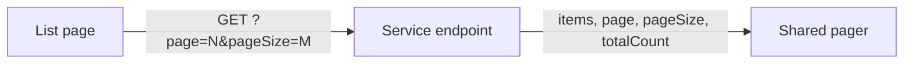

# List paging

Every table and list in the app loads one page at a time and shows the same pager.

## What it does

Every list uses server-side paging, with one shared pager component and one API paging shape.

The shape is `PagedResult<T>` from `WordBuddy.Shared.Kernel` 1.1.0 (Content, Identity, Progress).
Quiz stays on 1.0.1.

## Rules

| Rule | Value |
|---|---|
| Query params | `page` (default 1), `pageSize` (default 25) |
| Validation | `page >= 1`, `1 <= pageSize <= 100`; otherwise 400 |
| Page past the end | 200, empty `items`, real `totalCount` |
| Order | Existing order plus `Id` as last tie-breaker |
| `totalCount` | Counted after auth and child filters |

- **Child vs adult:** same pager for both; child restrictions still apply on every page. The shared pool counts child-visible words only. A child sees the challenge board as one page (top 5 plus own row). A child gets an empty page from `groups/owned`.

## API

| Route | Service | Auth |
|---|---|---|
| `GET /api/lessons/admin` | Content | AdminOnly |
| `GET /api/vocabulary/admin/lexemes` | Content | AdminOnly |
| `GET /api/vocabulary/moderation/pending`, `/moderation/autofill-pending` | Content | admin |
| `GET /api/vocabulary/learners/{id}/pending-approvals` | Content | supporter |
| `GET /api/vocabulary/mine` | Content | learner |
| `GET /api/vocabulary/shared` (+ `search`) | Content | learner |
| `GET /api/vocabulary/groups/{groupId}/words` | Content | group owner |
| `GET /api/auth/admin/unlink-requests`, `/admin/support-links` | Identity | AdminOnly |
| `GET /api/auth/groups/owned`, `/joined`, `/approvals` | Identity | learner |
| `GET /api/auth/groups/{id}/members` (new) | Identity | group owner |
| `GET /api/progress/challenges`, `/challenges/{id}/board` | Progress | learner |

`GET /api/auth/groups` was removed (split into `owned` and `joined`).

## UI

Shared `Pager` (Previous / Next, "Page X of Y"), `usePagination` hook, `PagedResult<T>` type. Used on
14 screens. Each keeps its error state. Filters reset to page 1.

## Pending changes

None.

## Change history

- `WB-55_apply-paging-to-table-list` (#55, PR #57) — server-side paging with a shared pager on every table/list
