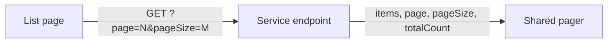

# List paging

Every table and list in the app loads one page at a time and shows the same pager.

## What it does

_Proposed — not on main yet._

Every table and list uses server-side paging, with one shared pager component and one API paging
shape.

## Rules

- **Child vs adult:** same pager for both; child content restrictions still apply on every page.

## API

| Method | Route | Service | Auth policy |
|---|---|---|---|

## UI

_To be defined by /plan._

## Pending changes

- `WB-55_apply-paging-to-table-list` — server-side paging with a shared pager on every table/list (#55)

## Change history
