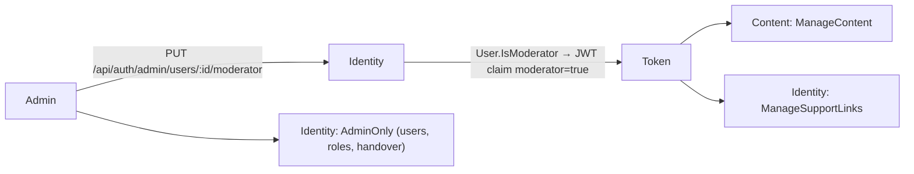

# Moderator role

A Moderator role lets trusted adults manage content data, so the admin does not carry all of it.

## What it does

- **Moderator** (data role): vocabulary moderation, lessons, lexemes, escalated unlinks of adult learners.
- **Admin** (user role): everything a moderator does, plus users, role assignment, handover and backfills.
- An admin grants or revokes Moderator on `/admin/users`. The token shows the change after the user's next sign-in.

| Area | Admin | Moderator (adult) | Adult learner | Child |
| --- | --- | --- | --- | --- |
| Vocabulary moderation (pending, moderate, autofill queue) | yes | yes (not own word) | no | no |
| Lesson authoring (`/api/lessons/admin`) | yes | yes | no | no |
| Lexeme admin (`/api/vocabulary/admin/lexemes`) | yes | yes | no | no |
| Escalated unlink requests | all | adult learners only, not own case | no | no |
| Primary handover, learner link lookup | yes | no | no | no |
| Backfills (`learner-words/republish`, `learner-profiles/republish`) | yes | no | no | no |
| Guardian role, Moderator role, user list | yes | no | no | no |

## Rules

- Only an admin grants or revokes Moderator (`AdminOnly`).
- A moderator cannot manage users or assign roles (403).
- A moderator cannot moderate their own shared word: 403 `PersonalVocabularyWord.ModerateOwnWordForbidden`, no state change. An admin can.
- A moderator cannot see or act on an unlink request they are party to (as learner or supporter): hidden in the list, 404 on complete or reject.
- A moderator never sees child learners' unlink requests: hidden in the list, 404 on complete or reject. No child data is exposed to moderators.
- A child cannot be a moderator: grant → 400 `User.ModeratorMustBeAdult`. An admin cannot be granted it: 400 `User.ModeratorNotForAdmin`. Revoke always works.
- An admin account cannot be deleted. No delete feature exists; the domain guard `User.EnsureCanBeDeleted()` returns 409 `User.AdminCannotBeDeleted` and any future delete command must call it.
- **Revoke lag:** there is no token refresh. A revoked moderator keeps the rights until the token expires, at most 60 minutes (`Jwt:ExpiryMinutes`).
- The moderator claim is also checked against `age_group != Child` in both policies (defence in depth).
- **Child vs adult:** only adult accounts can be moderators. Children see no change. The user list returns adult accounts only.
- The audit row of an unlink keeps the actor id in its `AdminId` column, also when a moderator acts.
- Development seed: `moderator@wordbuddy.com` (adult moderator) for e2e.

## API

| Method | Route | Service | Auth policy |
|---|---|---|---|
| PUT | `/api/auth/admin/users/{id}/moderator` body `{ isModerator }` (204; 400, 404) | Identity | `AdminOnly` |
| GET | `/api/auth/admin/users?search=&page=&pageSize=` (adults only, paged) | Identity | `AdminOnly` |
| GET | `/api/auth/admin/unlink-requests` | Identity | `ManageSupportLinks` |
| POST | `/api/auth/admin/unlink-requests/{id}/complete` · `/reject` | Identity | `ManageSupportLinks` |
| GET | `/api/auth/admin/support-links?learnerId=` | Identity | `AdminOnly` |
| POST | `/api/auth/admin/support-links/handover` | Identity | `AdminOnly` |
| any | `/api/lessons/admin/**` | Content | `ManageContent` |
| any | `/api/vocabulary/admin/lexemes/**` | Content | `ManageContent` |
| GET · POST | `/api/vocabulary/moderation/pending` · `/moderation/{id}` | Content | `ManageContent` |
| GET · POST | `/api/vocabulary/moderation/autofill-pending` · `/autofill/{senseId}/approve` | Content | `ManageContent` |
| POST | `/api/vocabulary/admin/learner-words/republish` | Content | `AdminOnly` |

Policy rule, both `ManageSupportLinks` and `ManageContent`: `is_admin` OR (`moderator` AND `age_group != Child`).

## UI

| Route | Who | Notes |
|---|---|---|
| `/admin/users` ("Users & roles") | admin | Search (email or name), paged list, Admin / Moderator / Guardian badges, Grant / Revoke Moderator (none on admin rows), note "Role changes apply at the user's next sign-in." |
| `/vocabulary/moderation`, `/admin/lessons`, `/admin/lexemes`, `/admin/support-links` | admin, adult moderator | Sidebar group shown on `canManageContent` |
| Primary handover (in `/admin/support-links`) | admin | Moderators see "Requests of child learners go to an admin." |

- Role helpers in `src/utils/roles.ts` (`isAdmin`, `canManageContent`) are display only. The server decides.
- Known gap: a moderator who approves their own word gets 403 and the UI shows no message.

## Pending changes

None.

## Change history

- `WB-56_moderator-role-to-assist-admin` (#56, PR #58) — `User.IsModerator`, `moderator` claim, `ManageContent` and `ManageSupportLinks` policies, `/admin/users` screen, own-case guards, admin delete guard
