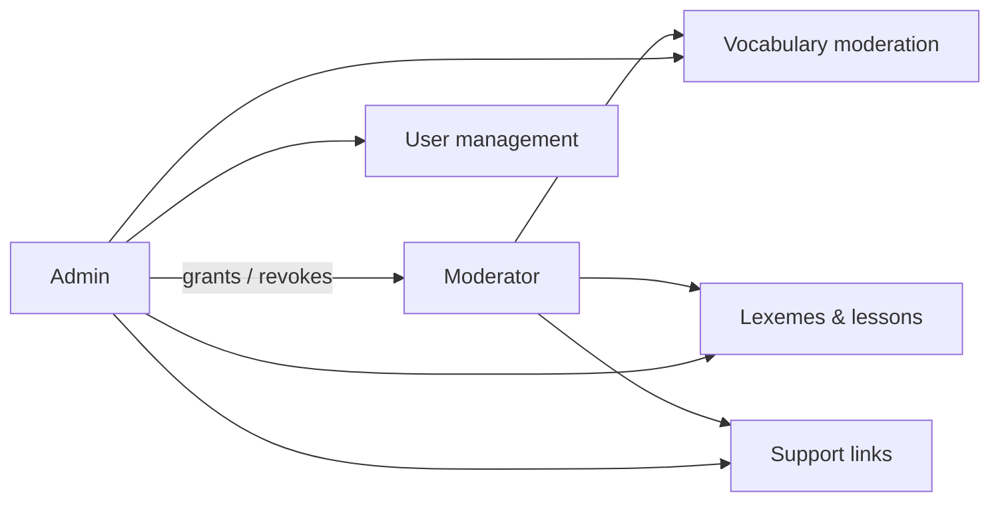

# Moderator role

A Moderator role lets trusted adults manage content data, so the admin does not carry all of it.

## What it does

_Proposed — not on main yet._

- **Moderator** (data role): vocabulary moderation, lexemes & lessons, support links.
- **Admin** (user role): everything a moderator does, plus users and role assignment.

## Rules

- Only an admin grants or revokes Moderator.
- A moderator cannot manage users or assign roles.
- A moderator cannot see child account data.
- An admin account cannot be deleted.
- **Child vs adult:** only adult accounts can be moderators; children see no change.

## API

| Method | Route | Service | Auth policy |
|---|---|---|---|

## UI

_To be defined by /plan._

## Pending changes

- `WB-56_moderator-role-to-assist-admin` — add a Moderator role that manages content data (#56)

## Change history
