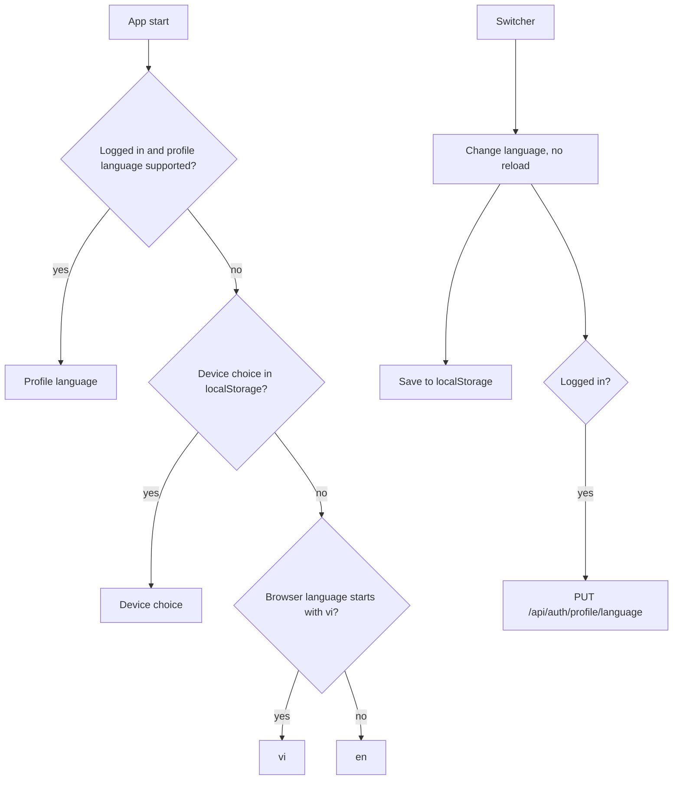

# Multilingual UI (English and Vietnamese)

Learners use the app's interface in English or Vietnamese. The choice follows them to any device.

## What it does

- Every UI string comes from typed translation files (`en`, `vi`); a missing key fails `tsc`.
- The switcher is on the login and register pages and in the sidebar. The text changes at once, without a reload.
- Logged in: the choice is saved to the profile and restored after login on any device.
- Before login: the device choice wins, else the browser language (`vi` gives Vietnamese, else English).
- Register sends the current UI language as the first profile language.
- If saving fails, the UI keeps the new language and shows an inline error.
- Dates and numbers follow the language. Known API error codes are translated; other errors show a translated generic message in `vi`.
- Not translated: lesson content (vocabulary, grammar, daily phrases, quizzes), user-entered text, notifications, emails.
- A third language needs one new `src/i18n/locales/<code>/` folder and one entry in `SUPPORTED_LANGUAGES`. No backend change.

## Rules

- Supported languages: `en`, `vi`. Default: `en`.
- The server checks the code format only (`^[a-z]{2,3}(-[a-z0-9]{2,8})?$`, max 10 characters); null clears it. The UI decides what is supported.
- Wrong format gives `400` (`User.InvalidLanguage`). No token gives `401`.
- Saving the language does not publish `LearnerProfileUpdated`, has no new JWT claim, and logs only the user id.
- **Child vs adult:** same switcher, same languages, same endpoint, own account only. Vietnamese copy on child screens uses short, simple words.

## API

| Method | Route | Service | Auth policy |
|---|---|---|---|
| PUT | `/api/auth/profile/language` (body `{ language }`, null clears; returns `UserDto`) | Identity | `[Authorize]`, own account |
| POST | `/api/auth/register` (optional `preferredLanguage`) | Identity | anonymous |
| GET | `/api/auth/me` and login reply (add `preferredLanguage`) | Identity | `[Authorize]` / anonymous |

## UI

- `src/i18n/` (config, resources, `applyLanguage`), `components/LanguageSwitcher.tsx`, `hooks/useLanguageSync.ts`.
- Profile language is applied once per login. Logout keeps the current language.

## Pending changes

None.

## Change history

- `WB-59_multilingual-ui-english-and-vietnamese` (#59, PR #60) - i18next setup, `en`/`vi` translations for all screens, switcher, `User.PreferredLanguage` and `PUT /api/auth/profile/language`
