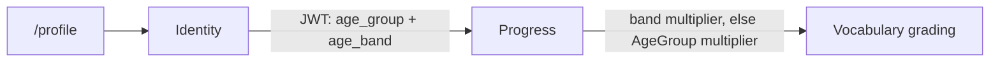

# User profile

A user views and updates their own account on `/profile`: display name, date of birth, password. A child also sees their linked supporters.

## What it does

- Page sections: alias and avatar, account info (email, age group, display name), date of birth, time zone, change password, My supporters.
- Date of birth stays in Identity. The token carries only the age band (`age_band` claim). No date in logs or events.
- Saving the date of birth or the password returns a new token, so the band refreshes without a new login.
- Progress grades future reviews with the band multiplier. Without a band it uses the WB-22 `AgeGroup` multiplier. Past `ReviewLog` rows are unchanged.
- Active supporters see the learner date of birth read-only on the Supporters page. Pending and ended links do not.

| Age band | Age | Default multiplier |
| --- | --- | --- |
| `Under7` | under 7 | 1.5 |
| `Age7To9` | 7 to 9 | 1.35 |
| `Age10To12` | 10 to 12 | 1.2 |
| `Age13To17` | 13 to 17 | 1.1 |
| `Adult` | 18 and over | 1.0 |

Multipliers are config: `Vocabulary:Grading:AgeBandMultiplier` in Progress.

## Rules

- **Child vs adult:** same screens and rights. Each user edits their own date of birth, display name and password.
- Date of birth: not in the future, age 3 to 120. A `Child` must be under 18, an `Adult` 13 or older. Otherwise `400`.
- A child display name is never shown to others; the alias is the public name.
- Display name: 2 to 50 characters.
- Password change: current password required, new password 8 to 128 characters and different from the current one. Wrong current password gives `400`.
- Rate limit: password change 5 per minute per user.
- Email is read-only.
- Known limit: older tokens stay valid until expiry after a password change (no revocation yet).

## API

| Method | Route | Service | Auth policy |
|---|---|---|---|
| GET | `/api/auth/me` (adds `email`, `dateOfBirth`, `ageBand`, own data only) | Identity | `[Authorize]` |
| PUT | `/api/auth/profile/date-of-birth` (body `{ dateOfBirth }`, null clears; returns token) | Identity | `[Authorize]`, own account |
| PUT | `/api/auth/profile/display-name` | Identity | `[Authorize]`, own account |
| POST | `/api/auth/profile/password` (returns token) | Identity | `[Authorize]`, `password-change` rate limit |
| GET | `/api/auth/support-links` (`asSupporter` Active entries add `learnerDateOfBirth`) | Identity | `[Authorize]` |

## UI

`/profile` components in `src/components/profile/`: `AccountInfoCard`, `DateOfBirthForm`, `ChangePasswordForm`, `TimeZoneForm`, `MySupportersCard`.

- Date of birth: date input, future date blocked in the browser, server errors shown inline. A child sees "Ask your guardian if you are not sure."
- My supporters: lists Active links, guardian (Primary) first with a "Guardian" badge. A child always sees the card; an adult only when links exist.
- Every mutation and the supporters query show an inline error.

## Pending changes

None.

## Change history

- `WB-20_create-user-profile-settings` (#20, PR #46) — date of birth, display name, password change, My supporters, `age_band` claim and band grading in Progress
