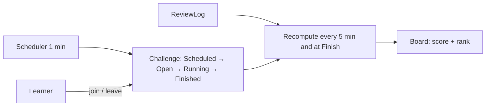

# Vocabulary challenges

Learners opt in to system-created challenges that score memory (reviews), not volume.

## What it does

Launch set (a new instance is created per period and audience):

| Template | Kind | Metric | Period | Audience |
| --- | --- | --- | --- | --- |
| Weekly League | Ranked | MemoryPoints | Mon–Sun | Adult and Child (separate instances) |
| 7-Day Memory | Target | DueReviewsCorrect, at least 1 on 7 local days | 7 days | Adult and Child |
| Word Climber | Target | RecallUpgrades, target 20 | 14 days | Adult and Child |
| Listening Sprint | Ranked | ListeningCorrect | 3 days | Adult only |

## Rules

- **Child vs adult:** audiences never mix (`Challenge.AudienceMismatch`). A child sees and joins
  challenges only after a guardian enables them. Child board: own row plus top 5, alias and fixed
  avatar only ("Child learner" if no alias). No user ids or messaging in any child DTO. Listening
  Sprint is never created for children. Adults see the full ranking with alias or display name.
- Lifecycle moves forward only. Join works while Open or Running. Capacity default 30; at capacity
  join fails with `Challenge.Full`.
- Score counts only rows after the join time and inside the challenge window (global UTC instants).
- Points per row: due, correct, first try, no hint +10; with hint +5; first correct Recall for a
  sense that only had correct Recognize +5; daily goal (10 correct due reviews in a local day) +10.
- Ignored rows: not due, wrong, `TimingAdjusted`, answer faster than 800 ms, first review of a sense.
- MemoryPoints cap: 200 per learner per local day. Listening Sprint counts correct due listening
  answers per learner with no daily cap.
- Local day uses the learner's IANA time zone; unknown or missing zone falls back to UTC.
- Guardian consent needs the Guardian role and an active support link to the child
  (`Challenge.NotGuardian`, `Challenge.NoActiveLink`). Children cannot hold the Guardian role.
- A guardian switching challenges off for a child removes the consent of every guardian of that
  child; a second guardian must switch it on again.
- A revoked support link removes the consent that supporter gave. Cleanup also runs on a replayed
  revoke, so a failed first attempt is repaired. Removing the Guardian role removes consent too.
- Progress keeps a local `ChallengeProfile` per user, filled by the idempotent
  `LearnerProfileUpdated` consumer (older events ignored).
- The cached board (`progress:challenge-board:{id}`, 5 min) holds a `UserId` per row. It is never
  sent in a DTO and expires with the cache entry. Child filtering happens after the cache read.
- Join is rate-limited.

## API

| Method | Route | Service | Auth policy |
|---|---|---|---|
| GET | `/api/progress/challenges` | Progress | authenticated (audience from `age_group`) |
| GET | `/api/progress/challenges/{id}/board` | Progress | authenticated, same audience |
| POST | `/api/progress/challenges/{id}/join` | Progress | authenticated, rate-limited |
| DELETE | `/api/progress/challenges/{id}/join` | Progress | authenticated |
| PUT | `/api/progress/challenges/consent/{childId}` | Progress | `GuardianOnly` (`guardian` claim) |

Identity adds `User.TimeZoneId` and `User.IsGuardian`, the `guardian` JWT claim, and publishes
`LearnerProfileUpdated`.

## UI

- `/challenges`: cards with join / leave; "This challenge is full"; child without consent sees
  "Ask your guardian".
- `/challenges/:challengeId`: adult table, or child own rank plus top 5.
- Profile settings: time zone select. Supporter dashboard: "Allow challenges" toggle per child,
  shown only with the `guardian` claim.

## Paging (WB-55)

`GET /api/progress/challenges` returns a paged result. The board `entries` field is a paged result. For a child the board ignores `page` and `pageSize`: it is always page 1 with the top 5 plus the own row, so a child cannot page past the top 5.

## Pending changes

None.

## Change history

- `WB-29_vocabulary-challenges` — first release of challenges, boards, guardian consent, time zones.
- `WB-55_apply-paging-to-table-list` (#55, PR #57) — paged challenge list and board
