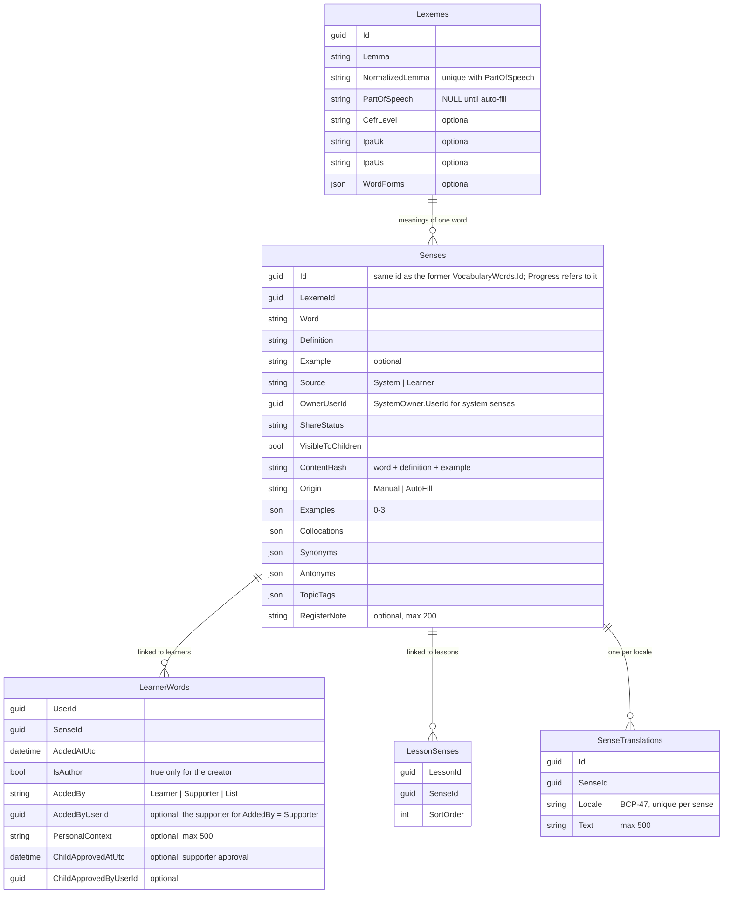

# Vocabulary storage

Every vocabulary meaning — system or learner — is one `Senses` row in Content. Senses of the same word share one `Lexemes` row (ADR 0004).

## What it does

- Adding a new learner word reuses the lexeme with the same normalized lemma and `PartOfSpeech = NULL`, or creates one.
- Deleting the last sense of a lexeme also deletes the lexeme. A lexeme shared with another sense stays.
- `GET /api/lessons/{id}` JSON is unchanged.
- Personal vocabulary DTOs carry `isAuthor` (always `false` on shared and moderation lists).
- Shared-pool DTOs carry `isMine` (`true` only when the caller owns the word).
- Word DTOs carry optional auto-fill fields (`partOfSpeech`, IPA, audio URLs, `examples`, `translations`, enrichment lists, `origin`, `awaitingApproval`). See `vocabulary-autofill.md`.
- Auto-fill sets `PartOfSpeech`, IPA and audio on lexemes and moves System/Shared senses to the POS lexeme.

## Rules

- **Dedupe on add.** Same normalized Word + Definition + Example (`ContentHash`) → link to an existing word, no new row. Preference: caller's own → system → shared word the caller can see. Never another learner's private word.
- **Adopt** (`add-to-mine`) creates a link, not a copy. Adopting twice is a no-op and returns the shared word's id.
- **Delete** depends on the caller and the word status:

  | Caller | Status | `?confirm=true` needed | Effect |
  | --- | --- | --- | --- |
  | Author | `Shared` | Yes (else 409 `PersonalVocabularyWord.DeleteConfirmationRequired`) | Word handed over to System (`OwnerUserId = SystemOwner.UserId`, `OwnerAgeGroup = null`); stays `Shared` in the pool; author link removed; adopters keep their links; pool cache cleared |
  | Author | `PendingReview` | Yes (else 409) | Share request cancelled (`Private`); link removed; row deleted if nothing else links to it |
  | Author | `Private` / `Rejected` | No | Link removed; row deleted if nothing else links to it |
  | Adopter | any | No | Link removed |

  No link → 404. The former author can re-adopt a handed-over word; the new link has `isAuthor = false`.
- **Share** is author-only. A non-author gets 409 (`PersonalVocabularyWord.InvalidShareRequest`). System words cannot be shared.
- **Edit** (`PUT /api/vocabulary/{id}`) is owner-only and only for a `Private` sense. It changes word, definition and example in place:
  - The sense id stays the same, so Progress history is kept.
  - Audio is cleared when the word changes. The image is kept.

  | Case | Status |
  | --- | --- |
  | Not the caller's word (no link / not mine) | 404 |
  | System word or another owner's word | 403 |
  | `PendingReview`, `Shared` or `Rejected` sense | 409 |
  | Same word + definition + example already exists | 409 |
  | Concurrent add (`PersonalVocabularyWord.ConcurrentAdd`) | 409 |

  Children and adults can both edit their own private words.
- **Personal note** (`LearnerWords.PersonalContext`, max 500 chars) is private to the caller:
  - Optional `personalContext` on all add flows: own word, shared pool (`add-to-mine`, optional body) and auto-fill.
  - `PUT /api/vocabulary/{id}/personal-context` sets or clears it (204). Over 500 chars → 400 `LearnerWord.PersonalContextTooLong`. No link → 404.
  - Returned only in the caller's own list (`GET /mine`, check) and review exercises. Never in the shared pool or moderation lists.
  - An existing note is never overwritten by a duplicate add or a lost concurrent add.
  - The note text is never logged.
  - Same for Child and Adult. A Child's note stays private to the child.
- **Concurrency.** Simultaneous identical add / adopt calls resolve to the same word or link — no 500.
- **Child vs adult:**
  - A Child cannot request sharing (`CanShareVocabulary`, 403).
  - A Child sees and adopts only shared words with `VisibleToChildren = true`; adults see all.
  - The child filter (`VisibleToChildren`) applies per `Sense`, not per `Lexeme`: two meanings of one word can differ.
  - A `Shared` word always applies the child filter, also after hand-over to System.
  - Dedupe (and the migration) never links a Child to a word the Child cannot see, including System words.
  - Admins moderate (`AdminOnly`) regardless of their own age group.
  - An `AutoFill` sense is hidden from a Child until approved by an admin (global) or the child's supporter (that child's link only).

### Accepted limitations

| Limitation | Impact |
| --- | --- |
| `ß` and similar letters | C# and SQL Server upper-case differently (`ß` ≠ `SS`), so such words may not dedupe against rows the migration hashed. Worst case: a harmless duplicate. |

## API

| Method | Route | Service | Auth policy |
|---|---|---|---|
| POST | `/api/vocabulary` | Content | authenticated |
| GET | `/api/vocabulary/mine` | Content | authenticated |
| POST | `/api/vocabulary/{id}/share` | Content | `CanShareVocabulary` (not Child, or admin) |
| PUT | `/api/vocabulary/{id}` | Content | authenticated (owner, `Private` only) |
| PUT | `/api/vocabulary/{id}/personal-context` | Content | authenticated (own link) |
| DELETE | `/api/vocabulary/{id}[?confirm=true]` | Content | authenticated |
| GET | `/api/vocabulary/shared` | Content | authenticated (Child: child-visible only) |
| POST | `/api/vocabulary/shared/{id}/add-to-mine` | Content | authenticated (Child: child-visible only) |
| GET | `/api/vocabulary/check` | Content | authenticated |
| GET | `/api/vocabulary/moderation/pending` | Content | `AdminOnly` |
| POST | `/api/vocabulary/moderation/{id}` | Content | `AdminOnly` |

## UI

- `/vocabulary` (My words): the Share action appears only when `isAuthor` is `true`. Adopted and system words show no Share button.
- Deleting an own `Shared` or `PendingReview` word opens a confirm dialog (see `vocabulary-builder.md`).
- `/vocabulary`: the add form has an optional "Where did you meet this word?" note with the hint "Only you can see this note.". Each card shows the note with Add / Edit / Clear.
- `/vocabulary/shared`: each card has an "Add a note" toggle before **Add to My List**.
- `/vocabulary/shared`: own words show a "Your word" badge instead of **Add to My List**.

## Paging (WB-55)

`GET /api/vocabulary/mine` and `GET /api/vocabulary/shared` return `{ items, page, pageSize, totalCount }`. The shared pool also takes a `search` filter (case-insensitive contains on the word). For a child, `totalCount` counts child-visible words only. The moderation lists (`/moderation/pending`, `/moderation/autofill-pending`) are paged the same way.

## Pending changes

None.

## Change history

- `refactor-database-scheme-to-store-vocabulary-item` (#6) — one `VocabularyWords` table plus user and lesson link tables; adopt creates a link; Progress pulls id remaps
- `WB-12_defect-on-sharing-word` (#12, PR #13) — delete of a shared word needs confirmation and hands the word over to System; `isMine` on the pool; child filter for System-owned shared words; `VocabularyWordIdRemaps` table, `/internal/vocabulary-remaps` routes and Progress sync removed
- `WB-16_vocabulary-lexeme-sense-model` (#16, PR #17) — `VocabularyWords` split into `Lexemes` + `Senses` (same ids); `LearnerWords` (`AddedBy`, `PersonalContext`), `LessonSenses`, `SenseTranslations`; API JSON unchanged
- `WB-25_vocabulary-autofill` (#25, PR #37) — `Senses.Origin` + enrichment fields, `LearnerWords` child approval columns, lexeme POS/IPA/audio from auto-fill
- `WB-27_learning-groups` (#27, PR #39) — `LearnerWords.AddedBy = Supporter` is now written by group assignment (`AddedByUserId` = the supporter, also the `LearnerWordAdded.AddedBy`); `GroupWordAssignments` history and `LearnerGroupMemberProjections` tables; see `learning-groups.md`
- `WB-48_edit-own-vocabulary-word` (#48, PR #52) — owner-only in-place edit of `Private` senses (`PUT /api/vocabulary/{id}`); sense id kept; audio cleared on word change, image kept
- `WB-49_personal-context-on-learner-word` (#49, PR #53) — optional personal note on every add flow; `PUT /api/vocabulary/{id}/personal-context`; note on `GET /mine`; UI field and editor
- `WB-55_apply-paging-to-table-list` (#55, PR #57) — paged My words, shared pool (+ `search`) and moderation lists
